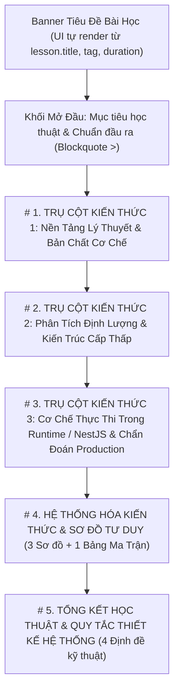

# QUY TRÌNH & ĐẶC TẢ TIÊU CHUẨN BIÊN SOẠN GIÁO TRÌNH BACKEND NESTJS
**(Tài liệu Chuẩn hóa Toàn diện — Lấy Bài 01 Chương 01 `c1-l1` làm Nguyên mẫu Chuẩn Vàng)**

---

## 1. MỤC ĐÍCH & ĐỊNH VỊ TIÊU CHUẨN

Tài liệu này quy định **quy trình biên soạn**, **cấu trúc học thuật**, **ràng buộc kỹ thuật tương thích UI/Engine**, và **tiêu chí nghiệm thu đầu ra** cho toàn bộ các bài học trong hệ thống **Arc Irobot Backend Academy**.

Bài học **`c1-l1` (Chương 1 - Bài 01: Từ Phần Cứng Đến Runtime: Bản Chất Long-Running Process & Bài Toán C10K)** tại [`src/data/curriculum/chapter1/c1-l1.ts`](file:///Users/hominhoanh/Documents/source/backend-nestjs/src/data/curriculum/chapter1/c1-l1.ts) và **`c1-l2` (Chương 1 - Bài 02: V8 Pipeline: Ignition, TurboFan, Hidden Classes & Deoptimization)** tại [`src/data/curriculum/chapter1/c1-l2.ts`](file:///Users/hominhoanh/Documents/source/backend-nestjs/src/data/curriculum/chapter1/c1-l2.ts) là **Nguyên mẫu Chuẩn Vàng (Golden Standard)**. Mọi bài học tiếp theo (`c1-l3` đến `c10-l*`) bắt buộc phải tuân thủ 100% khung sườn, kiến trúc tách file độc lập, độ sâu học thuật, định dạng dữ liệu và khả năng vận hành tính năng của `c1-l1` và `c1-l2`.

---

## 2. TRIẾT LÝ SƯ PHẠM & QUY TẮC VĂN PHONG HỌC THUẬT

### 2.1. Vai trò người biên soạn (Authoring Persona)
Người biên soạn đóng vai trò là **Giáo sư Khoa học Máy tính kết hợp Kiến trúc sư Hệ thống Chính (Principal Systems Architect)**:
- **Không viết kiểu tóm tắt bề nổi (High-level overview):** Tuyệt đối không liệt kê gạch đầu dòng chung chung kiểu tài liệu marketing hay blog sơ sài.
- **Giải thích từ nguyên lý gốc (First-Principles Thinking):** Mọi cơ chế của Node.js, TypeScript, NestJS, Database, Redis, Queue hay K8s đều phải được giải thích từ gốc rễ phần cứng (CPU, Cache, RAM, Disk, NIC), Hệ điều hành (Kernel, Syscall, File Descriptor, Thread/Process) hoặc Cấu trúc dữ liệu & Giải thuật nội tại trước khi đi lên tầng Framework.
- **Dìu dắt tư duy tuần tự (Pedagogical Scaffolding):** Luôn dẫn dắt người học theo mạch:
  1. *Định nghĩa khái niệm nền tảng & phân biệt ranh giới* $\rightarrow$
  2. *Phân tích cơ chế vật lý / nội tại kèm định lượng* $\rightarrow$
  3. *Đối chiếu mô hình Sai (Anti-pattern) và Chuẩn (Production Pattern) qua code thực tế* $\rightarrow$
  4. *Truy vết từng bước thực thi theo mốc thời gian (`t = 0 ms`, `t = 1 ms`...)* $\rightarrow$
  5. *Đúc kết quy tắc bất biến (Engineering Invariants)* $\rightarrow$
  6. *Thực hành lập trình 3 cấp độ từ Cơ bản đến Nâng cao*.

### 2.2. Quy chuẩn lọc văn phong (`no-ai-slop` & Chuẩn Báo Cáo Học Thuật)
1. **Nghiêm cấm tuyệt đối Emoji / Icon trang trí kiểu AI:**
   - Không sử dụng bất kỳ emoji nào (`🚀`, `💡`, `🔥`, `✨`, `🎯`, `⚠️`, `✅`, `❌`, `📌`, `🧠`...) trong tiêu đề, nội dung lý thuyết, câu hỏi trắc nghiệm hay đề bài tập.
   - Bố cục phân cấp hoàn toàn dựa vào hệ thống đánh số La Mã / Ả Rập (`# 1.`, `### 1.1`, `#### 1.`, `1.`, `-`), bảng biểu kỹ thuật và hộp trích dẫn học thuật (`>`).
2. **Nghiêm cấm các cụm từ sáo rỗng, kịch tính hóa kiểu AI (AI Slop):**
   - Cấm dùng: *"Trong thế giới công nghệ hiện đại..."*, *"Chìa khóa vàng..."*, *"Vũ khí bí mật..."*, *"Tuyệt chiêu..."*, *"Thần thánh..."*, *"Không thể thiếu..."*, *"Hãy cùng khám phá..."*, *"Tóm lại, việc hiểu rõ X là vô cùng quan trọng..."*.
   - Thay thế bằng mệnh đề kỹ thuật định lượng, trực diện: nêu rõ con số (`1–2 MB/thread`, `0.33 ns`, `Exit Code 137`), tên syscall (`epoll_ctl`, `clone`), tên thuật toán (`Cheney's Copying Algorithm`, `Tri-color Marking`).
3. **Chuẩn hóa thuật ngữ chuyên ngành song ngữ:**
   - Khi một thuật ngữ xuất hiện lần đầu trong mục, viết theo cấu trúc: **Tên tiếng Việt chuẩn xác (Thuật ngữ tiếng Anh gốc - Viết tắt nếu có)**.
   - Ví dụ: *Bộ quản lý bộ nhớ phần cứng (**MMU - Memory Management Unit**)*, *Đa nhiệm hợp tác bất đồng bộ (**Asynchronous Cooperative Multitasking**)*.

---

## 3. KIẾN TRÚC PHÂN TÁCH FILE MODULAR ("CHUẨN HÓA TỚI ĐÂU TÁCH RA TỚI ĐÓ — MỖI BÀI 1 FILE") & ĐẶC TẢ SCHEMA (`Lesson` Contract)

### 3.1. Quy tắc bắt buộc: 1 Bài Học = 1 File Độc Lập (`src/data/curriculum/chapterX/cX-lY.ts`)
Vì mỗi bài học đạt Chuẩn Vàng có dung lượng từ **800 đến 1,000 dòng mã nguồn**, việc gộp cả chương vào một file `chapterX.ts` duy nhất sẽ tạo ra các tập tin khổng lồ (2,500–4,000 dòng) gây khó bảo trì và chậm IDE. Do đó:
1. **Tách từng bài ra file riêng:** Mỗi bài học `c<X>-l<Y>` bắt buộc phải đặt trong file riêng tại đường dẫn `src/data/curriculum/chapter<X>/c<X>-l<Y>.ts` và export hằng số `export const c<X>_l<Y>: Lesson = { ... };`.
2. **File chương đóng vai trò Barrel / Aggregator:** Tập tin `src/data/curriculum/chapter<X>.ts` chỉ giữ vai trò import các bài học (`c<X>_l1`, `c<X>_l2`, `c<X>_l3`...) và export đối tượng `chapter<X>: Sprint` (dung lượng gọn nhẹ dưới 30 dòng).
3. **Nguyên tắc "Chuẩn hóa tới đâu tách ra tới đó":** Khi bắt đầu chuẩn hóa bất kỳ bài học nào thuộc `chapter<X>.ts`, kỹ sư thực hiện tách bài học đó (cùng các bài trong chương) ra thư mục `src/data/curriculum/chapter<X>/` trước hoặc ngay trong bước biên soạn.

### 3.2. Schema dữ liệu của một bài học (`Lesson`)
Mỗi bài học là một phần tử kiểu [`Lesson`](file:///Users/hominhoanh/Documents/source/backend-nestjs/src/data/curriculum/types.ts#L30-L41) được export từ `src/data/curriculum/chapterX/cX-lY.ts`:

```typescript
export interface Lesson {
  id: string;                      // Định dạng 'c<chương>-l<bài>', ví dụ: 'c1-l1', 'c2-l3'
  title: string;                   // Định dạng 'Bài XX: <Tên Học Thuật>: <Phụ Đề Kỹ Thuật>'
  duration: string;                // Thời lượng học tiêu chuẩn, ví dụ: '60 phút', '75 phút'
  tag: string;                     // Nhãn phân tầng kiến trúc (tiếng Anh ngắn gọn), ví dụ: 'Hardware & OS Layer'
  videoUrl?: string;               // (Tùy chọn) URL YouTube bài giảng nếu có
  theory: string;                  // Chuỗi Markdown học thuật đầy đủ 5 phần chuẩn hóa
  realCodeSnippet: string;         // Mã nguồn Production thực tế có header '// File: src/...'
  quiz: QuizQuestion[];            // Bắt buộc đủ 8 câu hỏi trắc nghiệm học thuật sâu
  codeChallenge: CodeChallenge;    // Bài tập Mức 1 (giữ tương thích ngược với hệ thống chấm điểm)
  codeChallenges: CodeChallenge[]; // Mảng đúng 3 bài tập phân tầng: 'basic', 'intermediate', 'advanced'
}
```

---

## 4. KHUNG SƯỜN BẮT BUỘC CỦA PHẦN LÝ THUYẾT (`theory`)

Trường `theory` của mọi bài học bắt buộc phải được tổ chức thành **1 Khối Mở Đầu + 5 Phần Chính (`# 1.` đến `# 5.`)**, ngăn cách nhau bởi đường kẻ ngang `---`.



### 4.1. Khối Mở Đầu: Mục tiêu học thuật & Chuẩn đầu ra (Bắt buộc ở dòng đầu tiên của `theory`)
- **Lưu ý UI:** Component [`TheoryTab.tsx`](file:///Users/hominhoanh/Documents/source/backend-nestjs/src/components/lesson/TheoryTab.tsx#L388-L395) đã tự động render `lesson.tag`, `lesson.duration` và `lesson.title` ở phần `.theory-lesson-header` trên cùng. Do đó, dòng đầu tiên của `theory` **bắt đầu ngay bằng khối `>` Mục tiêu học thuật** (sẽ hiển thị ngay bên dưới tiêu đề chính của bài học).
- **Cấu trúc chuẩn:**
```markdown
> **Mục tiêu học thuật & Chuẩn đầu ra của bài học:**
> Bài học này trang bị nền tảng [Lĩnh vực cốt lõi] từ cơ bản đến chuyên sâu cho kỹ sư Backend thông qua 3 trục kiến thức cốt lõi:
> 1. **[Trục 1 - Bản chất & Mô hình nền tảng]:** Hiểu rõ bản chất của [...]; phân biệt cơ chế vận hành giữa [...] và [...]; giải thích cơ chế phát sinh lỗi [...].
> 2. **[Trục 2 - Định lượng & Cơ chế nội tại]:** Phân tích định lượng [...]; chứng minh nguyên nhân vật lý/kỹ thuật khiến [...] và cơ chế hoạt động của [...].
> 3. **[Trục 3 - Thực thi & Vận hành Production]:** Phân biệt [...]; nắm vững cơ chế [...] và phương pháp thiết lập/chẩn đoán trên môi trường Production.

---
```

### 4.2. Cấu trúc Phần 1, Phần 2 và Phần 3 (Ba Trụ Cột Kiến Thức Chuyên Sâu)
Mỗi phần từ `# 1.` đến `# 3.` giải quyết trọn vẹn một trục kiến thức đã nêu ở Mục tiêu học thuật và bắt buộc phải có **3 đến 4 tiểu mục (`### X.1`, `### X.2`, `### X.3`, `### X.4`)** cùng **1 khối Tổng kết học thuật cuối phần**:

| Thành phần trong Phần 1–3 | Yêu cầu nội dung bắt buộc | Ví dụ đối chiếu từ Bài 1 (`c1-l1`) |
| :--- | :--- | :--- |
| **Tiểu mục Khái niệm gốc (`### X.1`)** | Định nghĩa từ gốc Khoa học Máy tính, giải thích từng thành phần cấu thành bằng danh sách đánh số `1. 2. 3.` kèm tiểu mục `-`. | `### 1.1 Khái niệm nền tảng: Chương trình (Program), Tiến trình (Process) và Luồng (Thread)` (Giải thích Text/Data/Heap/Stack Segment, PID, Registers). |
| **Bảng đối chiếu học thuật (`.technical-matrix-table`)** | Ít nhất 1 bảng Markdown từ **3 đến 5 cột**, tối thiểu **5 đến 6 hàng** tiêu chí kỹ thuật sâu để phân biệt các mô hình hoặc thông số. | Bảng đối chiếu `Client Runtime (Ephemeral)` vs `Server Runtime (Long-Running Daemon)` (6 tiêu chí), Bảng phân cấp độ trễ phần cứng (5 cột × 6 tầng), Bảng chẩn đoán 5 chỉ số `process.memoryUsage()`. |
| **Mã nguồn minh họa & Truy vết bộ nhớ/thời gian (`### X.2` / `### X.3`)** | Đoạn code `\`\`\`typescript` có dòng đầu tiên là `// File: src/...`, đặt cạnh nhau `THIẾT KẾ SAI (ANTI-PATTERN)` và `THIẾT KẾ CHUẨN`, theo sau là **Bảng truy vết theo mốc mili-giây (`t = 0 ms`, `t = 1 ms`...)** hoặc phân tích từng bước trên RAM/CPU. | Đoạn code `BillingServiceBroken` vs `BillingServiceSafe` (`// File: src/billing/billing.service.ts`) kèm bảng truy vết 5 mốc thời gian từ `t = 0 ms` đến `t = 12 ms`; Đoạn code `order-memory-trace.ts`. |
| **Khối Công thức & Định lượng kỹ thuật (`.theory-formula-box`)** | Dùng cặp dấu `\`\`\`` (không ghi tên ngôn ngữ) để trình bày công thức toán học, phép tính độ trễ, dung lượng bộ nhớ hoặc giới hạn cấu hình. | Công thức tính thời gian chờ hàng đợi `(N - 1) × T_CPU = 9,750 ms`; Phép tính RAM cho 10,000 luồng `10,000 × 1.5 MB = 15 GB RAM`. |
| **Hộp Tổng kết học thuật cuối phần (`>`)** | Kết thúc mỗi phần lớn bằng một khối blockquote `> **Tổng kết học thuật Phần X (...):**` đúc kết các quy tắc thiết kế cốt lõi trước khi sang phần tiếp theo. | `> **Tổng kết học thuật Phần 1 (Hai quy tắc thiết kế bất biến trên Long-Running Process):**` và `> **Tổng kết học thuật Phần 3 (Quy tắc lập ngân sách bộ nhớ - Container Memory Budgeting):**`. |

### 4.3. Cấu trúc Phần 4: Hệ thống hóa Kiến thức & Sơ đồ Tư duy (`# 4.`)
Phần 4 giúp sinh viên chuyển hóa toàn bộ văn bản dài ở Phần 1–3 thành mô hình thị giác thông qua **3 Sơ đồ (`\`\`\`diagram`)** và **1 Bảng Ma Trận Đánh Đổi Kỹ Thuật**:
- **`### 4.1 Sơ đồ 1: Bản Đồ Tầng Bậc Hệ Thống (System Taxonomy Map)`** $\rightarrow$ Kích hoạt bộ dựng `layered-stack` (hoặc Interactive Architecture Board).
- **`### 4.2 Sơ đồ 2: Dòng Chảy So Sánh ...`** hoặc **`Dòng Chảy Vòng Đời Thực Thi ...`** $\rightarrow$ Kích hoạt bộ dựng `comparison` hoặc `lifecycle-flow`.
- **`### 4.3 Sơ đồ 3: Cây Quyết Định Kỹ Thuật (...)`** $\rightarrow$ Kích hoạt bộ dựng `decision-tree`.
- **`### 4.4 Bảng tổng hợp: Ma Trận Đánh Đổi Kỹ Thuật (...)`** $\rightarrow$ Bảng Markdown 4 cột so sánh 3 phương án kiến trúc theo các tiêu chí định lượng.

### 4.4. Cấu trúc Phần 5: Tổng kết Học thuật và Quy tắc Thiết kế Hệ thống (`# 5.`)
Đúc kết **4 Định đề kỹ thuật (Engineering Invariants)** được đánh số `1. 2. 3. 4.` kết nối trực tiếp lý thuyết vừa học với mã nguồn thực tế (`realCodeSnippet`) ở ngay bên dưới.

---

## 5. QUY TẮC TƯƠNG THÍCH VỚI CÁC BỘ RENDER GIAO DIỆN (UI & ENGINE HOOKS)

Khi biên soạn nội dung Markdown trong `theory`, người biên soạn phải nắm rõ cách [`TheoryTab.tsx`](file:///Users/hominhoanh/Documents/source/backend-nestjs/src/components/lesson/TheoryTab.tsx) và [`detectDiagramCategory.ts`](file:///Users/hominhoanh/Documents/source/backend-nestjs/src/components/mindmap/detectDiagramCategory.ts) phân tích cú pháp để hiển thị đúng linh kiện UI:

### 5.1. Quy tắc 3 loại Fenced Code Block trong `theory`

| Mục đích hiển thị | Cú pháp khai báo trong `theory` | Component UI được kích hoạt | Quy tắc bắt buộc |
| :--- | :--- | :--- | :--- |
| **1. Khối Mã nguồn Kỹ thuật (Adaptive CodeViewer)** | `\`\`\`typescript` (hoặc `bash`, `sql`, `json`, `prisma`) | `.code-viewer-card` (Tự động đổi màu theo Light Mode / Dark Mode, có nút Sao chép & số dòng) | **Bắt buộc dòng 1** của code phải có comment chỉ định đường dẫn file: `// File: src/<module>/<name>.ts` để thanh tiêu đề hiển thị đúng tên file thay vì `example.ts`. |
| **2. Khối Công thức & Định lượng (Academic Formula Box)** | `\`\`\`` (để trống tên ngôn ngữ, hoặc ghi `\`\`\`formula` / `\`\`\`math`) | `.theory-formula-box` (Hộp công thức có nhãn **CÔNG THỨC & ĐỊNH LƯỢNG KỸ THUẬT**) | Không dùng ký tự vẽ khung ASCII (`┌`, `│`, `──`, `▼`) bên trong khối công thức, nếu không bộ parser sẽ nhận nhầm thành sơ đồ `diagram`. |
| **3. Khối Sơ đồ Kỹ thuật & MindMap (Smart MindMap Visualizer)** | `\`\`\`diagram` | `renderSmartMindMapHtml` (Chuyển đổi thành UI Card/SVG tương tác, hỗ trợ Pan/Zoom/Fullscreen/Inspector) | Đặt ngay dưới thẻ `###` (ví dụ `### 4.1 Sơ đồ 1: ...`). Bộ parser sẽ tự động lấy nội dung thẻ `###` làm tiêu đề trên thanh Header của sơ đồ và ẩn thẻ `###` dư thừa bên ngoài. |

### 5.2. Quy tắc kích hoạt đúng 6 Bộ Dựng Sơ Đồ (`detectDiagramCategory.ts`)
Hệ thống có 6 bộ dựng sơ đồ chuyên biệt trong `src/components/mindmap/renderers/`. Để kích hoạt chính xác bộ dựng mong muốn, tiêu đề `###` đứng ngay trước khối `\`\`\`diagram` và cấu trúc văn bản bên trong phải tuân thủ quy tắc sau:

1. **Bộ dựng `layered-stack` (`renderLayeredStack.ts` — Đa Topology Sơ Đồ Tư Duy Theo Nội Dung Bài Học):**
   - **Cách kích hoạt:** Tiêu đề `###` chứa một trong các từ khóa: `"Bản Đồ"`, `"Taxonomy"`, `"Tầng Bậc"`, `"Phân Cấp"`, `"Phân Phối"`, `"Architecture Map"`.
   - **Cấu trúc nội dung:** Chia thành các hộp tầng `1. TẦNG ...`, `2. TẦNG ...`, `3. TẦNG ...` nối nhau bằng mũi tên `│ <Giao thức / Chuyển tiếp>...` / `▼`. Bên trong mỗi tầng dùng `├── Tên: Mô tả` hoặc chuỗi ngang `[ Thành phần A (Thông số A) ] ◄───► [ Thành phần B (Thông số B) ]`.
   - **Quy tắc Đa Topology Sơ Đồ Tư Duy (`detectMindmapTopology`):** Nghiêm cấm ép mọi bài học vào chung 1 mẫu sơ đồ cố định. Tab `Sơ Đồ Tư Duy (Mindmap)` tự động dựng 1 trong **4 Topology Excalidraw (`excalidraw-sketch-svg`)** tùy theo bản chất kiến trúc của bài học (hoặc chỉ định tường minh qua dòng đầu `[TOPOLOGY: <loại>]`):
     - `taxonomy-tree`: Sơ đồ phân nhánh đa tầng (>= 4 tầng, ví dụ Bài `c1-l1` từ Hardware $\rightarrow$ Kernel $\rightarrow$ Node.js $\rightarrow$ NestJS).
     - `pipeline-feedback-loop`: Sơ đồ chuỗi đường ống thực thi ngang kèm vòng phản hồi tối ưu hóa & thoát lui (ví dụ Bài `c1-l2` V8 Parsing $\rightarrow$ Ignition Bytecode & IC $\rightarrow$ TurboFan JIT + OSR Deopt Bailout; Bài `c2-l3` Multi-Isolate Transfer Pipeline).
     - `dual-cycle-loop`: Sơ đồ vòng lặp kép (`Inner Loop ↔ Outer Loop`) kèm thanh ranh giới nền tảng (ví dụ Bài `c1-l3` OS `cgroups` RSS + Vòng lặp Young Gen Scavenger $\leftrightarrow$ Vòng lặp Old Gen Orinoco Major GC; Bài `c2-l1` V8 Call Stack + Vòng lặp Microtask $\leftrightarrow$ Vòng lặp 6 pha Libuv).
     - `orbital-cycle`: Sơ đồ chu trình 3 trụ cột cân đối cho các hệ thống phân luồng/định tuyến 3 tầng (ví dụ Bài `c2-l2` Node.js API $\leftrightarrow$ Libuv Routing $\leftrightarrow$ Linux Kernel `epoll`).
2. **Bộ dựng `comparison` (`renderComparisonFlow.ts`):**
   - **Cách kích hoạt:** Tiêu đề `###` chứa từ khóa `"So Sánh"`, `"Comparison"`, `"vs"` HOẶC nội dung chứa `"MÔ HÌNH CŨ:"` / `"MÔ HÌNH HIỆN ĐẠI:"` / `"KỊCH BẢN 1:"`.
   - **Cấu trúc nội dung:** Chia làm 2 khối rõ rệt (cách nhau bằng 1 dòng trống): khối đầu là mô hình cũ/anti-pattern, khối hai là mô hình hiện đại/best-practice, các bước nối nhau bằng `──►`.
3. **Bộ dựng `decision-tree` (`renderDecisionTree.ts`):**
   - **Cách kích hoạt:** Tiêu đề `###` chứa từ khóa `"Cây Quyết Định"` hoặc `"Decision Tree"`.
   - **Cấu trúc nội dung:** Dòng đầu là câu hỏi gốc viết hoa, phân nhánh bằng `/ \` sang các lựa chọn và kết quả nằm trong ngoặc vuông `[ TÊN KẾT QUẢ ]` kèm các dòng mô tả `- ...`.
4. **Bộ dựng `memory-layout` (`renderMemoryLayout.ts`):**
   - **Cách kích hoạt:** Tiêu đề `###` hoặc nội dung chứa `"RESIDENT SET SIZE"`, `"Phân Vùng Bộ Nhớ"`, `"V8 HEAP SPACE"`.
5. **Bộ dựng `lifecycle-flow` (`renderLifecycleFlow.ts`):**
   - **Cách kích hoạt:** Tiêu đề `###` chứa `"Dòng Chảy"`, `"Flow"`, `"Lifecycle"`, `"Vòng Đời"`, `"Quy Trình"` (và không chứa từ `"So Sánh"`).
6. **Bộ dựng `blueprint` (`renderCleanBlueprint.ts`):**
   - Dự phòng cho mọi sơ đồ kiến trúc dạng hộp không thuộc 5 nhóm trên.

---

## 6. ĐẶC TẢ MÃ NGUỒN THỰC TẾ (`realCodeSnippet`)

Trường `realCodeSnippet` hiển thị ở cuối tab Lý thuyết dưới tiêu đề **"Mã Nguồn Thực Tế Từ Dự Án (Production Reference)"**. Yêu cầu bắt buộc:
1. **Dòng 1:** Khai báo chính xác đường dẫn file theo cấu trúc dự án NestJS thực tế:
   `// File: src/<module>/<tên-file>.<controller|service|guard|interceptor|module>.ts`
2. **Dòng 2:** Mô tả bối cảnh sử dụng của file trong hệ thống Production:
   `// Trích dẫn từ dự án thực tế Arc Irobot Backend - <Chức năng cốt lõi của file>`
3. **Nội dung mã nguồn:**
   - Độ dài tiêu chuẩn: **45 – 90 dòng code TypeScript/NestJS hoàn chỉnh**.
   - Phải có JSDoc giải thích **Lý do thiết kế kiến trúc (Architectural Decision Record - ADR)** gắn liền với lý thuyết vừa học trong bài.
   - Tuyệt đối không dùng kiểu `any`, không viết code giả (pseudo-code) dạng `// TODO: implement later`.

---

## 7. ĐẶC TẢ BỘ CÂU HỎI KHẢO THÍ (`quiz`)

Mỗi bài học bắt buộc phải có **đúng 8 câu hỏi trắc nghiệm** (`c<X>-l<Y>-q1` đến `c<X>-l<Y>-q8`):

1. **Phân bổ ma trận kiến thức (8 câu):**
   - **Câu 1 & Câu 2:** Kiểm tra kiến thức Phần 1 (Mô hình nền tảng, trạng thái bộ nhớ, phân biệt kiến trúc).
   - **Câu 3 & Câu 4:** Kiểm tra kiến thức Phần 2 (Định lượng độ trễ, cơ chế cấp thấp, phân tích hiệu năng).
   - **Câu 5 & Câu 6:** Kiểm tra kiến thức Phần 3 (Cơ chế thực thi trong NestJS/V8/Runtime và kịch bản lỗi thực tế).
   - **Câu 7 & Câu 8:** Kiểm tra tư duy vận hành Production, cấu hình hệ thống và mã nguồn thực tế (`realCodeSnippet`).
2. **Quy tắc thiết kế 4 phương án (`options`):**
   - Mỗi câu có đúng 4 phương án (`options.length === 4`), `correctIndex` từ `0` đến `3` (phân bổ đều các vị trí `0, 1, 2, 3`, không đặt đáp án đúng cố định ở một vị trí).
   - **Độ dài đồng đều:** 3 phương án nhiễu (distractors) phải được viết với độ dài và văn phong kỹ thuật tương đương với đáp án đúng (sai ở bản chất cơ chế chứ không phải câu ngô nghê ngắn cụt).
3. **Quy tắc viết giải thích (`explanation`):**
   - Độ dài tối thiểu **2–3 câu hoàn chỉnh**, giải thích trực diện nguyên lý vật lý/kỹ thuật vì sao đáp án đúng là chính xác và hậu quả thực tế nếu hiểu sai.

---

## 8. ĐẶC TẢ BÀI TẬP CODE SANDBOX ĐA CẤP ĐỘ (`codeChallenge` & `codeChallenges`)

Đây là phần quan trọng nhất để **dìu dắt sinh viên từ hiểu lý thuyết sang tự tay viết được code chạy thực tế**.

### 8.1. Cấu trúc 3 Cấp độ Bắt buộc (Progressive Scaffolding)
Mỗi bài học bắt buộc phải cung cấp mảng `codeChallenges` gồm **3 bài tập theo cấp độ tăng dần** (và gán bản sao của Bài Mức 1 vào trường `codeChallenge`):

| Cấp độ | Giá trị `level` | Giá trị `levelLabel` | Mục tiêu sư phạm của bài tập |
| :--- | :--- | :--- | :--- |
| **Bài 1** | `'basic'` | `'Mức 1 · Cơ bản (Làm quen công thức)'` | Giúp sinh viên chuyển hóa 1 công thức hoặc quy tắc phân loại đơn giản vừa học trong bài thành hàm xử lý đầu vào/đầu ra cơ bản. |
| **Bài 2** | `'intermediate'` | `'Mức 2 · Trung bình (Mô hình hoá hệ thống)'` | Kết hợp nhiều công thức/trạng thái để mô phỏng một bộ tính toán hoặc thuật toán điều phối hệ thống (ví dụ: mô hình hàng đợi M/M/1, bộ cấp phát, bộ định tuyến). |
| **Bài 3** | `'advanced'` | `'Mức 3 · Nâng cao (Chuẩn Production)'` | Kết hợp xử lý dữ liệu phức hợp (Object/Array) với **Lập trình phòng thủ (Defensive Guard)**: kiểm tra kiểu dữ liệu đầu vào, bắt điều kiện biên và chủ động `throw new Error("<MÃ_LỖI_CHUẨN>")` khi dữ liệu vi phạm. |

### 8.2. Các trường bắt buộc để UI Dìu Dắt Sinh Viên hoạt động đầy đủ
Trong từng đối tượng `CodeChallenge`, người biên soạn bắt buộc phải điền đầy đủ 8 trường sau:

1. **`title`:** `'Bài <1|2|3>: <Tên Bài Tập Ngắn Gọn & Rõ Nghĩa>'`.
2. **`description`:**
   - Nêu rõ bối cảnh kỹ thuật liên hệ với bài học.
   - Ghi rõ tên hàm cần viết (ví dụ: ``Hãy viết hàm `checkHeapStatus(heapUsedBytes, maxHeapMb)`...``).
   - Nêu rõ công thức toán học, các ngưỡng phân loại (`"CRITICAL"`, `"WARNING"`, `"HEALTHY"`), cấu trúc object trả về và quy tắc làm tròn số (ví dụ: *Mọi số thực trả về đều làm tròn đến 2 chữ số thập phân*).
3. **`guidedSteps` (Mảng 4 chuỗi hướng dẫn từng bước):**
   - Hiển thị trong hộp **"HƯỚNG DẪN TƯ DUY & CÁC BƯỚC GIẢI (STEP-BY-STEP GUIDE)"** trên UI.
   - Mỗi phần tử bắt đầu bằng `'Bước 1 (...): ...'`, `'Bước 2 (...): ...'`, `'Bước 3 (...): ...'`, `'Bước 4 (...): ...'`.
   - Phải chỉ dẫn cụ thể biến nào chia cho số nào, kiểm tra điều kiện gì và trả về object có những key nào để sinh viên đọc xong có thể viết code ngay.
4. **`hints` (Mảng 2 chuỗi gợi ý kỹ thuật):**
   - Giải đáp các vướng mắc thực tế về ngôn ngữ JavaScript/TypeScript (ví dụ: cách làm tròn giữ nguyên kiểu `number` bằng `Math.round(x * 100) / 100` thay vì `.toFixed(2)`, cách kiểm tra `null` trước `typeof obj !== 'object'`).
5. **`starterCode`:**
   - Khai báo đúng chữ ký hàm `function <tenHam>(<thamSo1>, <thamSo2>) { ... }` kèm 4 dòng comment `// Bước 1: ...`, `// Bước 2: ...` khớp với `guidedSteps`.
6. **`solution`:**
   - Lời giải mẫu hoàn chỉnh, sạch, vượt qua 100% `testCases`.
7. **`testCases` (Tối thiểu 4–5 test cases cho mỗi bài):**
   - **3 Test Cases Công Khai (`hidden: false`):** Bắt buộc phải có `name` mô tả rõ kịch bản, `input` tường minh và `expected` tường minh. Component [`CodeSandboxEditor.tsx`](file:///Users/hominhoanh/Documents/source/backend-nestjs/src/components/lesson/CodeSandboxEditor.tsx#L676-L708) sẽ tự động đọc các test case `hidden: false` này để render khu vực **"ĐẶC TẢ INPUT / OUTPUT MẪU (VISIBLE TEST SPECS)"** cho sinh viên đối chiếu trước khi bấm chạy code.
   - **1–2 Test Cases Ẩn (`hidden: true`):** Kiểm tra điều kiện biên chính xác (`>=`, `<=`), số thập phân lẻ hoặc kịch bản ném lỗi (`expected: 'ERROR_THROWN'`).

### 8.3. Ràng buộc Kỹ thuật của Máy chấm `CodeEvaluator` (Web Worker Sandbox)
Khi viết `starterCode`, `solution` và `testCases`, bắt buộc tuân thủ 5 quy tắc kỹ thuật của [`src/services/codeEvaluator.ts`](file:///Users/hominhoanh/Documents/source/backend-nestjs/src/services/codeEvaluator.ts):
1. **Cách nhận diện hàm mục tiêu:** `CodeEvaluator` tìm hàm đầu tiên khớp biểu thức `/(?:async\s+)?(?:function\*?|class)\s+([A-Za-z0-9_$]+)/`. Do đó:
   - Hàm chính sinh viên cần viết **phải là hàm đầu tiên** được khai báo bằng từ khóa `function <tenHam>(...)` (không đặt hàm helper `function round2()` lên trước hàm chính; nếu dùng helper thì khai báo bên trong hàm chính dạng `const round2 = (n) => ...`).
   - Không dùng từ khóa `export` trước `function` trong `starterCode` và `solution`.
2. **Kiểm thử ngoại lệ (`ERROR_THROWN`):** Nếu muốn kiểm tra sinh viên có `throw new Error(...)` khi dữ liệu đầu vào sai hay không, đặt `expected: 'ERROR_THROWN'` trong `TestCase`.
3. **So sánh kết quả (`equal`):** Máy chấm so sánh sâu (deep equality) các phần tử của Array và các key-value của Object (bỏ qua 2 key `timestamp` và `createdAt` nếu có).
4. **Tính khả tuần tự hóa (`Serializable`):** Mọi giá trị trong `input` và `expected` phải tuần tự hóa được qua `postMessage` của Web Worker (`number`, `string`, `boolean`, `null`, `Array`, plain `Object`). Không dùng `Map`, `Set`, `Symbol` hay `BigInt` trực tiếp trong `input`/`expected`.
5. **Giới hạn thời gian chạy:** Mỗi lần chạy toàn bộ test cases trong Worker có timeout cứng là **4,000 ms (4 giây)**.

---

## 9. QUY TRÌNH 6 BƯỚC BIÊN SOẠN & NGHIỆM THU MỘT BÀI HỌC

Để chuẩn hóa một bài học bất kỳ (ví dụ `c1-l2`, `c1-l3`...) đạt chuẩn `c1-l1`, thực hiện tuần tự 6 bước sau:

### Bước 1: Xác định 3 Trục Kiến Thức & Lập Dàn Ý Học Thuật
- Đọc chủ đề của bài học và chia thành 3 phần lớn (`# 1.`, `# 2.`, `# 3.`) theo tiến trình: **Cơ sở lý thuyết & Hệ điều hành/Phần cứng** $\rightarrow$ **Cơ chế nội tại & Định lượng hiệu năng** $\rightarrow$ **Ứng dụng kiến trúc trong NestJS & Chẩn đoán sự cố Production**.
- Xác định trước các bảng đối chiếu (tối thiểu 2–3 bảng), các công thức định lượng (tối thiểu 1–2 hộp công thức), và các đoạn mã truy vết sẽ đưa vào từng phần.

### Bước 2: Biên soạn Nội dung Lý thuyết (`theory`) & Sơ đồ Tư duy (`# 4.`, `# 5.`)
- Viết khối `> **Mục tiêu học thuật & Chuẩn đầu ra của bài học:**` ở đầu `theory`.
- Biên soạn chi tiết Phần 1, 2, 3 theo phong cách giáo trình đại học chuyên sâu, kèm bảng truy vết và hộp `> **Tổng kết học thuật Phần X:**`.
- Thiết kế Phần 4 gồm 3 sơ đồ `\`\`\`diagram` (kích hoạt đúng các bộ dựng `layered-stack`, `comparison`/`lifecycle-flow`, `decision-tree`) và 1 bảng ma trận đánh đổi kỹ thuật.
- Viết Phần 5 gồm 4 định đề kỹ thuật (Engineering Invariants).
- Rà soát bằng bộ lọc `no-ai-slop`: xóa sạch emoji và mọi câu văn chung chung không chứa thông tin kỹ thuật.

### Bước 3: Chuẩn hóa Mã nguồn Thực tế (`realCodeSnippet`)
- Biên soạn hoặc trích xuất một file NestJS thực tế (`Controller`, `Service`, `Interceptor`, `Guard`, `Custom Decorator`, `Module`...), bổ sung dòng `// File: src/...` ở dòng 1 và chú thích kiến trúc đầy đủ.

### Bước 4: Thiết kế 8 Câu hỏi Khảo thí (`quiz`) & 3 Bài tập Sandbox (`codeChallenges`)
- Soạn đủ 8 câu hỏi trắc nghiệm bao phủ cả 3 phần lý thuyết và `realCodeSnippet`.
- Soạn đủ 3 bài tập Code Sandbox (`basic`, `intermediate`, `advanced`), mỗi bài có đầy đủ `guidedSteps` (4 bước), `hints` (2 gợi ý), `starterCode`, `solution`, và `testCases` (3 công khai + 2 ẩn).
- Sao chép bài `basic` vào trường `codeChallenge` để đảm bảo tương thích ngược.

### Bước 5: Kiểm tra Tự động Lời giải & Biên dịch Hệ thống
- Kiểm tra thực thi tất cả `solution` của cả 3 bài tập trong `codeChallenges` đối với toàn bộ `testCases` (cả công khai và ẩn) để đảm bảo pass 100%.
- Chạy lệnh kiểm tra kiểu dữ liệu và đóng gói:
  ```bash
  npm run build
  npm run test:admin
  ```

### Bước 6: Đối chiếu Danh mục Nghiệm thu 21 Điểm (QA Checklist)
Một bài học chỉ được công nhận là **Hoàn thiện Chuẩn Vàng** khi đạt đủ 21/21 tiêu chí dưới đây:

| STT | Hạng mục kiểm tra | Tiêu chuẩn nghiệm thu bắt buộc |
| :---: | :--- | :--- |
| **1** | **Khối Mục tiêu bài học** | Nằm ngay đầu chuỗi `theory` dưới dạng blockquote `>`, nêu rõ 3 trục kiến thức cốt lõi. |
| **2** | **Độ sâu Phần 1, 2, 3** | Đủ 3 phần lớn (`# 1.`, `# 2.`, `# 3.`), mỗi phần có 3–4 tiểu mục `###` giải thích từ nguyên lý gốc. |
| **3** | **Bảng thông số kỹ thuật** | Toàn bài có tối thiểu 3 bảng Markdown đa cột (4–5 cột), số liệu định lượng chính xác. |
| **4** | **Code mẫu trong lý thuyết** | Mọi block `\`\`\`typescript` trong `theory` đều có `// File: src/...` ở dòng 1 và so sánh Anti-pattern vs Best-practice. |
| **5** | **Bảng truy vết thực thi** | Có bảng truy vết từng bước theo mốc thời gian (`t = 0 ms`...) hoặc trạng thái bộ nhớ cho đoạn code trọng tâm. |
| **6** | **Hộp công thức định lượng** | Có tối thiểu 1–2 khối công thức toán học/hiệu năng dùng block `\`\`\`` để hiển thị `.theory-formula-box`. |
| **7** | **Tổng kết từng phần** | Cuối các phần lý thuyết có khối `> **Tổng kết học thuật Phần X:**` đúc kết quy tắc thiết kế. |
| **8** | **Phần 4 - Sơ đồ tư duy** | Có đủ 3 sơ đồ `\`\`\`diagram` (`4.1` Taxonomy, `4.2` Comparison/Flow, `4.3` Decision Tree) + `4.4` Bảng ma trận. |
| **9** | **Phần 5 - Định đề kỹ thuật** | Có đủ 4 định đề kỹ thuật (Engineering Invariants) đánh số `1. 2. 3. 4.` ở cuối phần lý thuyết. |
| **10** | **Chuẩn `no-ai-slop`** | 0% emoji trong toàn bộ bài học; 0% văn phong sáo rỗng kiểu AI; thuật ngữ song ngữ chuẩn xác. |
| **11** | **`realCodeSnippet`** | Có `// File: src/...` ở dòng 1, code NestJS chuẩn Production dài 45–90 dòng, có JSDoc giải thích kiến trúc. |
| **12** | **Số lượng & chất lượng `quiz`** | Đủ 8 câu hỏi (`q1`–`q8`), 4 đáp án có độ dài tương đương, `explanation` giải thích sâu bản chất. |
| **13** | **Đủ 3 bài tập `codeChallenges`** | Đủ 3 cấp độ `basic`, `intermediate`, `advanced` và đồng bộ bài Mức 1 vào `codeChallenge`. |
| **14** | **Hướng dẫn `guidedSteps`** | Mỗi bài tập có đủ 4 bước hướng dẫn tuần tự (`Bước 1` $\rightarrow$ `Bước 4`), không bị trùng lặp số bước. |
| **15** | **Gợi ý `hints`** | Mỗi bài tập có 2 gợi ý kỹ thuật thực tế giúp tránh bẫy ngôn ngữ / làm tròn số. |
| **16** | **Visible Test Cases** | Mỗi bài tập có ít nhất 2–3 test case `hidden: false` với `input` và `expected` rõ ràng để hiển thị trên UI. |
| **17** | **Hidden & Edge Test Cases** | Mỗi bài tập có 1–2 test case `hidden: true` kiểm tra điều kiện biên hoặc ném lỗi `'ERROR_THROWN'`. |
| **18** | **Khớp `starterCode` & `solution`** | Hàm mục tiêu đặt đầu tiên, không có `export`, `solution` chạy pass 100% `testCases`. |
| **19** | **Hiển thị Light / Dark Mode** | Toàn bộ bảng biểu, sơ đồ, hộp công thức và `CodeViewer` hiển thị sắc nét trên cả Light Mode và Dark Mode. |
| **20** | **Kiến trúc Modular 1 Bài = 1 File** | Tách bài học thành file riêng tại `src/data/curriculum/chapterX/cX-lY.ts` và import vào barrel `src/data/curriculum/chapterX.ts`. |
| **21** | **Build & Test hệ thống** | `npm run curriculum:validate <id>`, `npm run build` và `npm run test:admin` đạt 100% PASS. |

