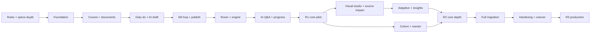

# Roadmap — phase/sprint/release

DRAFT 0.2 · Chỉ kế hoạch, chưa implementation · Scope0.1 và effort cũ đã thay thế.

**R1 phải có một luồng sản phẩm hoàn chỉnh**, từ content/tài liệu qua giáo án/đồ hoạ đến lớp AI 1-1 có hỏi đáp/checkpoint/resume. Không đẩy AI authoring và graphics ra sau một đợt làm quản trị chung quá dài.

## 1. Bản đồ

| Phase | Mục tiêu/giá trị | Sprint | Release | Effort PD |
|---|---|---|---|---|
|[P00](phases/P00-definition/README.md)|Duyệt baseline, specs, rules và skills trước setup |S00 |Pre-setup |4–7 |
|[P01](phases/P01-foundation/README.md)|3 repo, auth/access/contracts đủ chạy core |S01 |R1 |12–18 |
|[P02](phases/P02-content/README.md)|Course/content/documents→giáo án→đồ hoạ→preview/publish |S02–S04 |R1 |38–58 |
|[P03](phases/P03-classroom/README.md)|Room/engine1-1→conversation/checkpoint/resume/summary |S05–S06 |R1 |28–42 |
|[P04](phases/P04-core-depth/README.md)|Visual studio, adaptive teaching, source impact, mentor/lớp |S07–S09 |R2 |34–52 |
|[P05](phases/P05-production/README.md)|Migration scope, quality/perf/restore/cutover |S10–S11 |R3 |22–34 |

Mỗi phase chứa sprints, mỗi sprint có README/specs/stories JSON đầy đủ. [Sprint index JSON](sprint-index.json) là dữ liệu kế hoạch để đối soát với canonical stories.

## 2. Sprint convention và capacity

Planning window đề xuất2 tuần/sprint, **không phải cam kết mọi package dưới đây vừa một người trong2 tuần**. Capacity thực tế dùng4 PD/người/tuần,8 PD/người/window; S05 cần16–24 PD nên ít nhất2–3người có chuyên môn tương ứng hoặc tách sub-sprint trước duyệt. Không giấu effort thừa bằng overtime hay tính AI như dev độc lập.

S00 là work documentation4–7PD đề xuất cho toàn bộ refinements/review chưa hoàn tất; không phải claim đã dùng4–7ngày trong phiên này. Implementation totals R1=78–118 PD; R2=34–52PD; R3=22–34 PD. Tổng implementation=**134–204 PD**; dự phòng25%→**168–255PD**, cộng S00=**172–262PD**. Chưa gồm author viết lại40 bài, chờ reviewer/procurement, phí provider/hosting và support ngoài cửa sổ nghiệm thu.

| Nhân sự | R1 implementation lý tưởng trước buffer | Cả3release implementation lý tưởng trước buffer |
|---|---|---|
|1 dev,4 PD/tuần |20–30tuần |34–51tuần |
|2 dev,8 PD/tuần |10–15tuần |17–26tuần |
|3 dev,12 PD/tuần |7–10tuần |12–17tuần |

Đây là capacity arithmetic, chưa cộng25%buffer/chờ duyệt/đường găng/coordination. Không biến bảng thành deadline. Re-estimate sau S03/S06 dựa schema fit, engine port và chất lượng source. Nếu1 dev thì sprint package phải chia nhỏ, không coi12 sprint=24tuần chắc chắn.

## 3. Gate và core demo

- **G0 / S00:** ĐẠI CA duyệt BRD/architecture/SRS/stories/shared+sprint specs/rules/skills và blocking decisions cho sprint tiếp theo. Chưa G0 không setup repo/config/dependency/codegen/spike.
- **Foundation / S01:**3 repo independent build, cookie/access negative smoke qua edge, contract regeneration reproducible, baseline monitoring/backup/secrets/quota hooks. Không mở public khi privacy/auth chưa đạt.
- **Content / S04:**Editor từ tài liệu dựng giáo án và visuals, reviewer publish package; Web preview/student dùng cùng renderer. Fixture c1-l1 và một bài khác chủ đề để tránh schema overfit.
- **R1 / S06:**Demo full chain trong BRD, student hỏi bám nguồn/checkpoint, server quiz và single-writer resume đa thiết bị; browser/text fallback. Pilot dataset/user list giới hạn được ĐẠI CA duyệt; không hứa full migration40 bài ở R1.
- **R2 / S09:**Studio và adaptive explanations có review/evaluation, source update impact, lớp/mentor đúng scope. Không expand thành shared video hoặc generic plugin marketplace.
- **R3 / S11:**Full core manifest migration, unsupported legacy policy ký rõ, browser/perf/security/UAT report, off-host restore và cutover sign-off. Go-live approval riêng, không ngầm từ G0.

## 4. Ưu tiên và phạm vi

P01 chỉ build platform đủ cho P02/P03, không dành sprint làm dashboard/admin generic trước content. AI prompt/quota/source context từ S03, browser voice/fallback S05, tutor/instructor S06. Backup/audit/access làm baseline từ S01, deepen ở S10/S11; không dời mọi yêu cầu vận hành đến cuối.

R1 có đồ hoạ typed/templates và AI soạn giáo án, chưa phải unlimited visual editor. R2 mở studio/presets/AI images nâng cao. Khoá/bài mới có thể soạn bằng manual khi provider lỗi. R1 dùng selected ready source spans, chưa cần vector infra; R2 đánh giá retrieval khi source lớn, nếu cần bổ sung index phải duyệt spec/effort riêng.

Thanh toán không nằm trong bất cứ phase/sprint/release nào. Thi/chứng chỉ nâng cao/forum không xếp lịch; bảo toàn archive/read-only legacy là nhiệm vụ migration, không phát triển feature đó.

## 5. Risk/owner cần chốt

| Risk | Bằng chứng cần trước gate | Vai trò xử lý |
|---|---|---|
|Nguồn tài liệu extraction kém/citation sai |Parser fixture thật, needs_ocr path, source spans và reviewed citations |Content reviewer/backend |
|Đồ hoạ đẹp nhưng không giảng được |Objective mapping, semantic review, narration/focus interruption demo |Editor/reviewer/Web |
|Engine port timing/memory regressions |Clock fixtures, cleanup/fallback real browser |Web |
|AI vượt quota/leak source |Concurrent reservation/negative scope/injection tests |Backend |
|Không đủ reviewer |Assigned review capacity và content rollout scope |ĐẠI CA/content owner |
|Scaffold sẵn có lệch kiến trúc |Read-only audit giữ/sửa/thay sau duyệt, không overwrite |Tech lead |
|Skill drift3 repo |Rule/skill manifest version/hash/source/ref/license |Tech lead |
|Migration mất dữ liệu local/ngoài scope |Exception/provenance/archive và user communication decision |Operator/ĐẠI CA |
|Post-write rollback mất ghi mới |Watermark/delta/reconcile hoặc roll-forward runbook |Operator |

Mọi sprint còn Pending. Báo cáo cuối sprint phải dẫn AC evidence thay vì chỉ đánh dấu done. Source-of-truth [user-stories.json](user-stories.json) và [sprint-index.json](sprint-index.json) phải đồng bộ với per-sprint copies.
