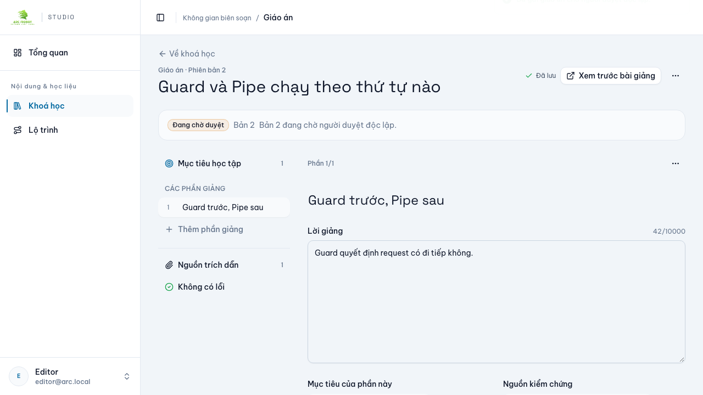
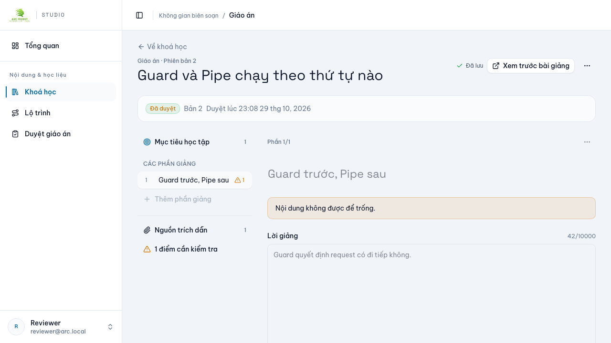
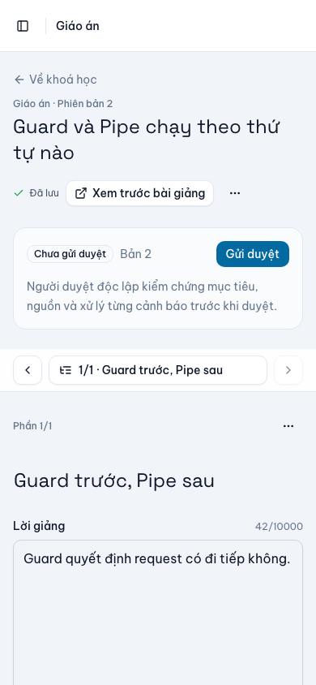

# US-012 — Review giáo án và kiến thức (local verification)

Ngày29/10/2026. ĐẠI CA chỉ đạo “check tiến độ và thực hiện công việc tiếp theo”; hạng mục còn lại của S03 là US-012 (human review), sau US-010/US-011 và nâng cấp UX biên soạn. Đợt này triển khai review decision gắn hash trên backend, UI duyệt trong plan editor và review queue trên CMS. Không mở publish giáo án, không commit/push/deploy.

## Execution contract đã triển khai

- Revision/plan version/content hash/input hash/findings snapshot được chụp tại thời điểm gửi duyệt; `teaching_plan_review` chỉ chuyển `pending → approved|rejected` một lần. Trigger DB chặn update sau decision, chặn đổi binding (revision, hash, findings, người gửi) và chặn xoá.
- `POST /i/v1/teaching-plans/{id}/review-submissions` (If-Match, owner có `teaching:plan:write`): idempotent theo `(planId, revisionId)`; không tạo review cho revision không phải bản hiện hành.
- `POST /i/v1/teaching-plans/{id}/review-decisions` (`content:lesson:review`, If-Match): chỉ định đoạt review `pending` đúng revision hiện hành; `contentHash` phải khớp; findings hiện tại phải trùng snapshot, nếu không trả412. Reviewer phải độc lập: không phải chủ khoá, tác giả revision hoặc người gửi duyệt (403).
- `approve` yêu cầu disposition phủ đúng toàn bộ finding, mỗi disposition có note; rule `source_unavailable`, `lesson_changed`, `schema_invalid` không thể waive (409). `reject` bắt buộc note ≥3 ký tự (400).
- `GET /i/v1/teaching-plans/{id}/review`: review gần nhất, approval gần nhất + `valid/staleReason`; approval hết hiệu lực khi plan version/content hash đổi, lesson input hash đổi hoặc findings/source thay đổi.
- `GET /i/v1/teaching-plans/reviews`: queue `pending` đúng revision hiện hành, loại khoá lưu trữ và bản của chính người duyệt; chỉ `content:lesson:review`.
- Audit `teaching.plan.review.submit|approve|reject` trong cùng transaction. Không có endpoint publish giáo án, nên AC-012-03 được enforce bằng approval validity + chặn decision trên revision mới, không tuyên bố publish.

## Phạm vi thay đổi

- Backend: migration `20261029110000_plan_reviews` (bảng + unique + trigger/constraint), `plan-review.ts` (rule thuần), service/controller/DTO review, OpenAPI + 4 Bruno templates. Migration chỉ chạy trên Postgres local `localhost:55433`.
- CMS: panel review trong plan editor (trạng thái, gửi duyệt, duyệt/từ chối, disposition từng finding), route + queue duyệt giáo án cho reviewer, i18n VI/EN, unit test panel.
- Web: không đổi; preview hiện hành không lộ answer key và không phụ thuộc review state.

## Evidence AC

| AC | Cách kiểm | Kết quả |
|---|---|---|
| AC-012-01 | E2E HTTP/Postgres: gửi duyệt bản hiện hành, replay idempotent, duyệt độc lập, decision gắn `contentHash`, dispositions lưu DB, audit đúng 1; unit test rule disposition; browser panel | PASS |
| AC-012-02 | E2E: reviewer/owner tự duyệt bị403; sửa nguồn/bài học sau khi gửi làm duyệt bị412; rule nguồn/lesson không thể waive (unit + service); không thể approve khi thiếu disposition | PASS |
| AC-012-03 | E2E: sau khi duyệt, lưu revision mới → `approval.valid=false`, `staleReason=plan_changed`; decision trên version mới trả409/412; browser hiển thị “Đã duyệt bản cũ” | PASS |

## Gates

| Gate | Kết quả |
|---|---|
| Backend prettier, eslint, typecheck | PASS |
| Backend `jest-coverage` (unit + HTTP/Postgres e2e) | 116/116 tests, 18 suites; statements 85.17%, branches 67.26%, functions 83.18%, lines 87.42% |
| Backend foundation, OpenAPI closure/reproducible, Bruno | PASS; internal 60 paths, 91 operation templates |
| Backend build/tsc tools + migration local | PASS (localhost only) |
| CMS foundation, structure, prettier, eslint, typecheck | PASS |
| CMS unit | 68/68 tests, 14 files; application statements 33.05% (không suy luận coverage cao từ số test) |
| CMS product/i18n | PASS 765 bilingual messages, placeholder parity |
| CMS generated API reproducible | PASS |
| CMS production build | PASS |
| CMS Playwright | 31/31 PASS (35.5s), gồm 5 scenario US-012 mới |

Chi tiết log: [backend-quality.log](backend-quality.log), [cms-quality.log](cms-quality.log), [cms-build.log](cms-build.log), [cms-browser.log](cms-browser.log), [cms-review-queue.log](cms-review-queue.log).

Ảnh (fixture HTTP, không phải backend thật):

## Test mới

- `test/plan-reviews.e2e-spec.ts` (5 test): submit/queue/permission; disposition bắt buộc; reject cần note; stale approval + source/lesson change; reviewer read-only/learner deny.
- `src/modules/teaching-plans/plan-review.spec.ts` (4 test): multiset findings, disposition coverage/note/unwaivable, stale reason.
- `src/modules/teaching-plans/views/PlanReviewPanel.test.tsx` (4 test): submit, waive bắt buộc, reject note, stale badge.
- `e2e/plan-review.spec.ts` (5 test): author submit, reviewer approve sau disposition, queue mở plan, stale + chặn editor vào queue, mobile 390px không tràn.

## Giới hạn / chưa chứng minh

- Browser test dùng HTTP fixture có state, không chạy với backend/Postgres thật trong flow UI; backend e2e mới là bằng chứng HTTP/Postgres thật.
- Chưa có con người thật đóng vai reviewer ký nghiệm thu nội dung/kiến thức (human sign-off vẫn pending). Đây là workflow review, không phải biên bản review nội dung.
- CMS application coverage còn thấp; không đánh dấu toàn bộ UI đã được coverage.
- Chưa commit/push/deploy; chưa chạy production migration. Không có publish giáo án; approval chưa được dùng bởi một publish endpoint vì S03 không mở publish.
- Chưa chạy lại toàn bộ live Gemini flow sau thay đổi review; US-011 live evidence giữ nguyên, không suy rộng.
