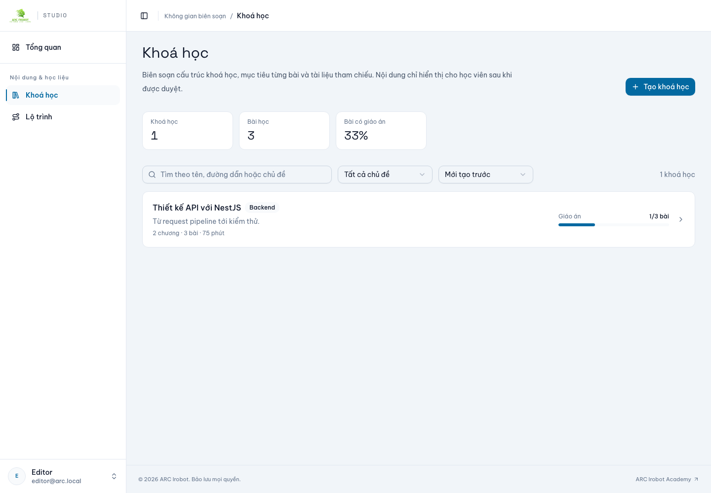
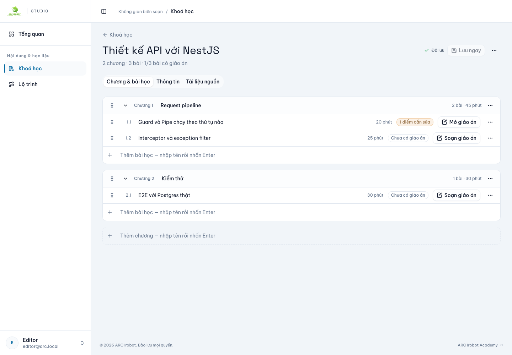
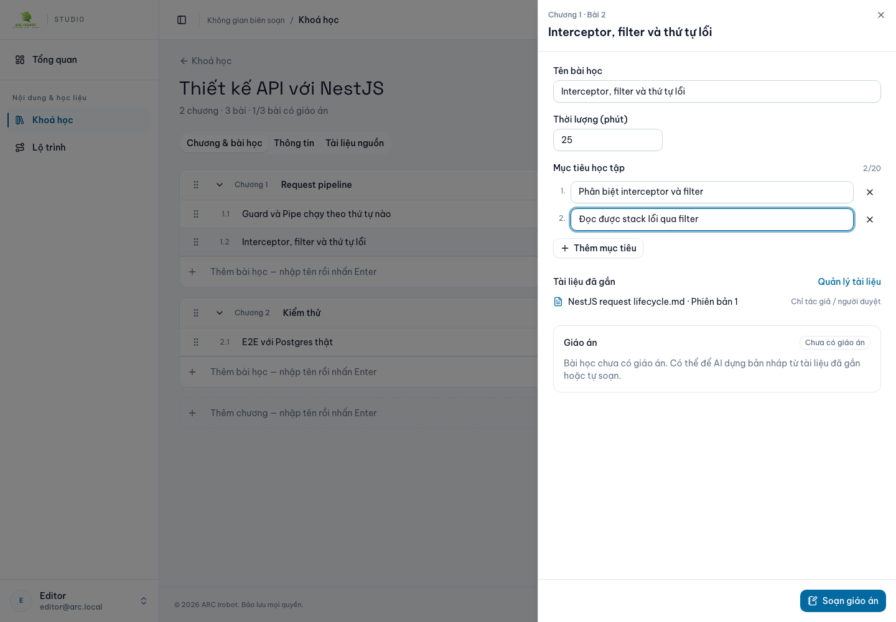
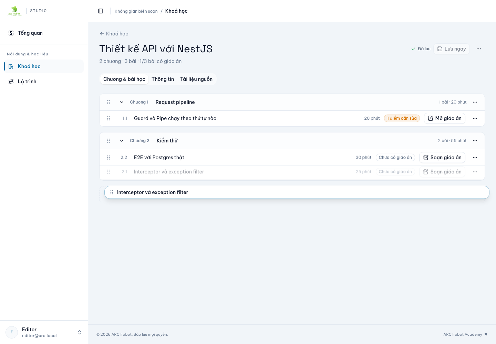
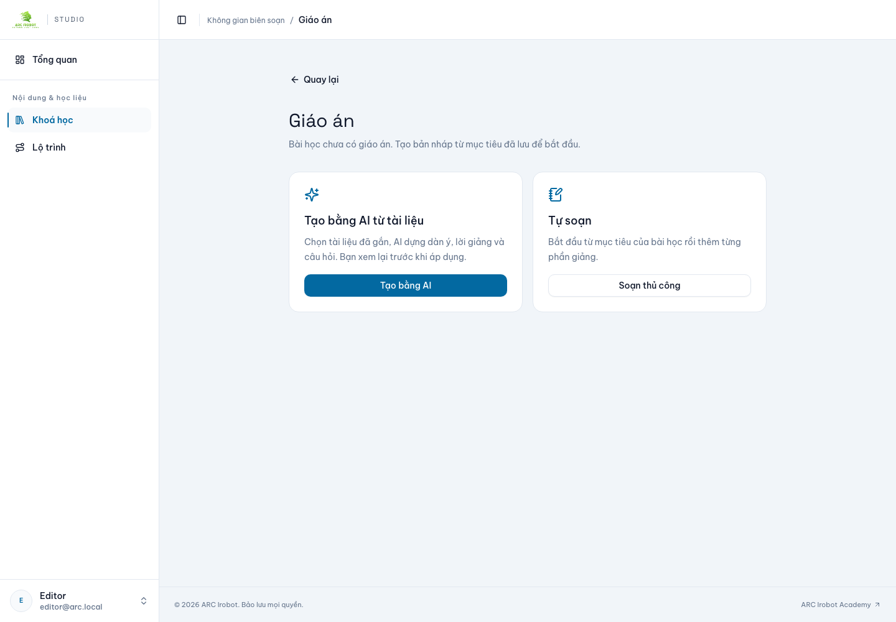
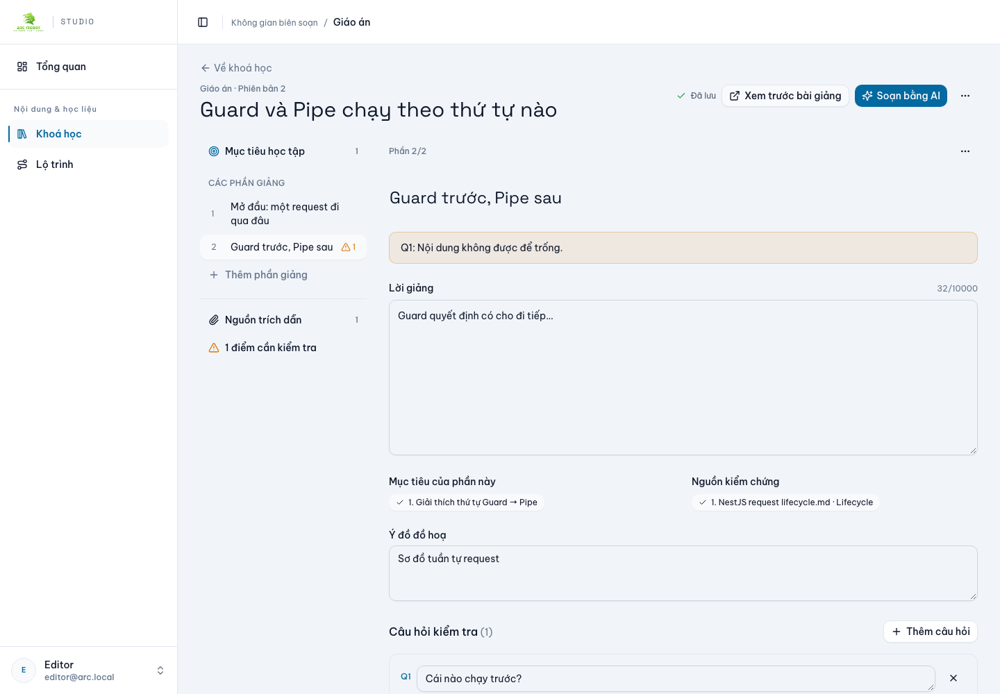
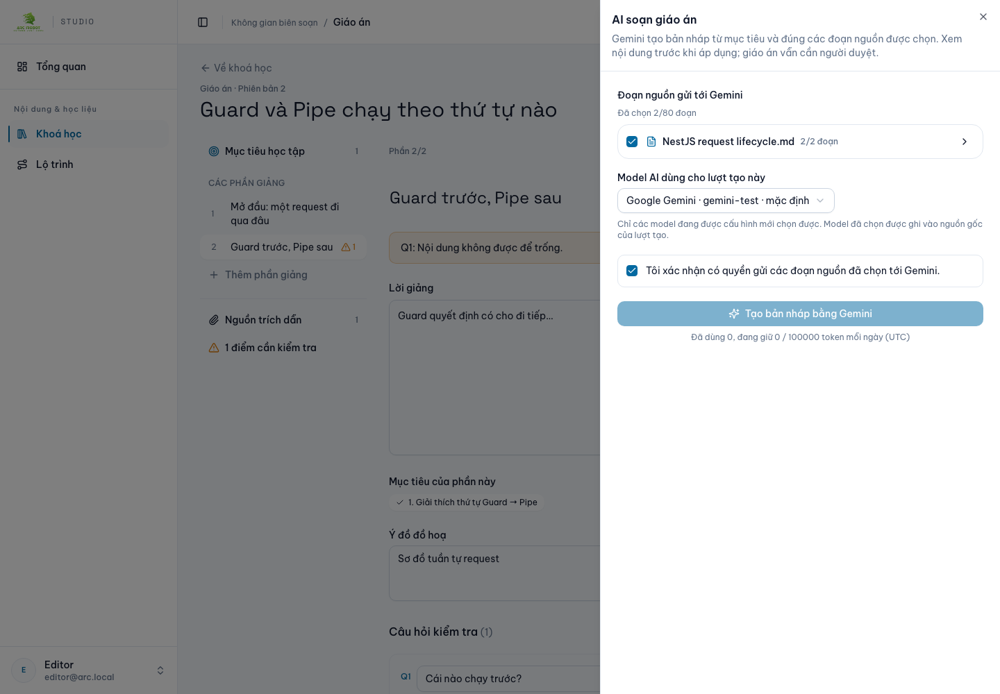
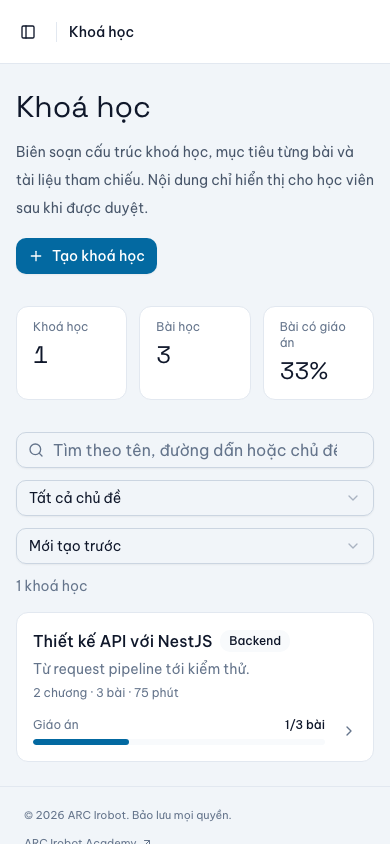
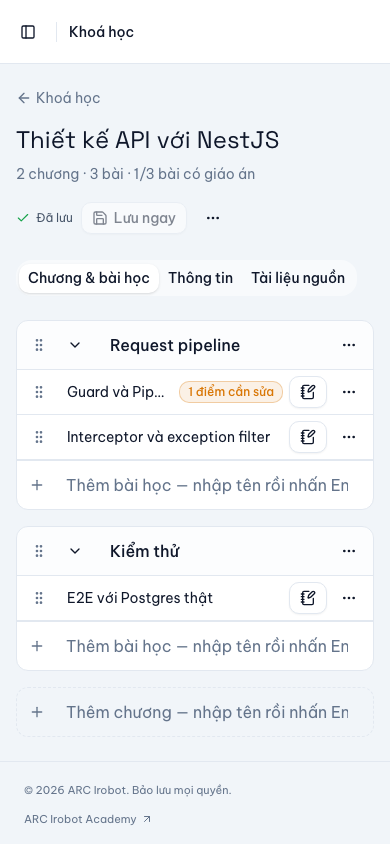
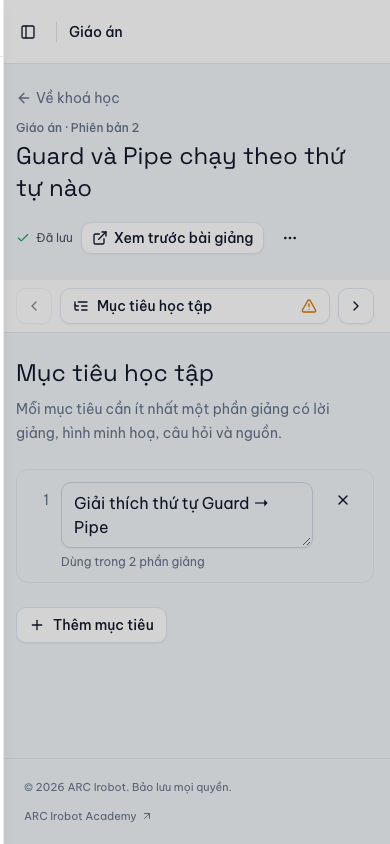

# Hồ sơ kiểm chứng — UX biên soạn khoá học & giáo án (29/10/2026)

Mô tả thay đổi: [implementation/AUTHORING-UX-2026-10-29.md](../../implementation/AUTHORING-UX-2026-10-29.md). Chưa commit; browser test dùng API fixture có state, không phải backend/Gemini thật.

## Log

| File | Nội dung | Kết quả |
|---|---|---|
| `backend-teaching-plans-e2e.log` | HTTP/Postgres local, gồm summaries + coverage | 6/6 PASS |
| `backend-checks.log` | api:check, bruno:check (87), typecheck, lint | PASS |
| `cms-quality.log` | `pnpm quality:check` | PASS |
| `cms-unit.log` | Vitest | 64/64 PASS |
| `cms-build.log` | Production build | PASS |
| `cms-e2e.log` | Toàn bộ Playwright | 26/26 PASS (41.8s) |
| `cms-e2e-course-authoring-rerun.log` | Spec course-authoring | 7/7 PASS |
| `cms-e2e-run1-under-load.log` | Lượt đầu khi load ~30 | 24/26, 2 timeout — không tính PASS |

## Testcase `e2e/course-authoring.spec.ts`

| # | Kịch bản | Kiểm tra |
|---|---|---|
| 1 | Outline + Sheet bài học | Badge giáo án/tổng 1/3, sửa tên + thêm mục tiêu trong Sheet → payload PUT draft đúng; thêm bài bằng Enter; xoá bài có giáo án bị khoá |
| 2 | Bài chưa có giáo án | Hai lựa chọn AI/Tự soạn; tạo, thêm phần, gắn mục tiêu → PATCH đúng |
| 3 | Editor + AI | Dàn ý, nhảy tới lỗi Phần 2 · Q1; panel AI chọn cả tài liệu, model mặc định hiển thị; PATCH thêm sourceRefs trước, POST plan-jobs gửi 2 ref + model |
| 4 | 390px | Outline và editor không tràn ngang |
| 5 | Danh sách khoá học | Coverage 1/3 (aria-valuenow 33), thống kê 33%, lọc chủ đề, xoá lọc, mobile không tràn, mở khoá |
| 6 | Kéo-thả | Chuột: kéo bài 1.2 sang chương 2 → payload chứa bài ở chương 2; bàn phím: đưa chương 2 lên đầu → payload thứ tự chương đúng |
| 7 | Mobile giáo án | Thanh dính Phần sau/dàn ý; Sheet dàn ý chọn Mục tiêu rồi tự đóng |

## Ảnh (fixture)

