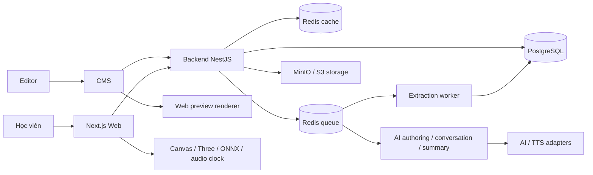
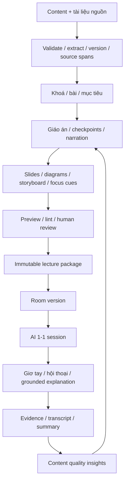

# Kiến trúc — content, giáo án, đồ hoạ và AI 1-1

DRAFT 0.2 · ADRs Proposed · Repo backend là **arc-academy-backend**; API là interface do backend cung cấp.

## 1. Ba repo

| Repo | Trách nhiệm | Cấu trúc đề xuất |
|---|---|---|
| arc-academy-backend | Domain/data/auth/content/documents/lesson composition/classroom/AI/jobs/ops; sinh contracts | src/modules/{platform,content,documents,teaching,visuals,classroom,ai,learning,cohorts}; src/workers; prisma; packages/contracts; openapi; bruno; docs |
| arc-academy-cms | Authoring workspace, document library, course/lesson editor, giáo án/visual studio, preview/review, room/class settings | src/app, src/core/{api,auth,permissions,ui}, src/modules/<feature>/{views,components,hooks,services,types} |
| arc-academy-web | Student library/lesson/document viewer, renderer, AI classroom, conversation, progress | src/app, src/core, src/features/{catalog,lesson,classroom,documents,progress}, src/lib/{tts,speech,canvas} |

Modular monolith NestJS; API process và worker deploy riêng từ cùng backend repo. Không microservices/multiple databases trong baseline. Ownership content schema/contracts thuộc backend; renderer thuộc Web; CMS preview dùng renderer đó, không viết engine thứ hai.

## 2. Content-to-classroom pipeline

Published lecture package pin lesson revision + plan revision + visual revision + source document revisions + renderer schema version + checkpoint policy. AI conversation context chỉ lấy snapshot phiên và permitted source spans. Cập nhật tài liệu không làm đổi nguồn của phiên đang chạy.

## 3. Domain và dữ liệu

| Context | Entity và invariant |
|---|---|
| Content | Course → Chapter → Lesson → LessonRevision; category/tag/roadmap; order unique trong parent; slug alias, published pointer |
| Documents | SourceDocument, DocumentRevision, ExtractionJob, SourceSpan, AttachmentLink; hash/object immutable, extraction version, page/section anchors, visibility scope |
| Teaching | TeachingPlanRevision: objectives/sections/slides/scripts/checkpoints/source refs; authored/AI draft provenance; review hash |
| Visuals | VisualRevision: discriminated payloads/semantic labels/layout/timeline/narration cues/media refs; rendererVersion, alt descriptions |
| Publication | LecturePackage immutable + ReviewDecision; content/plan/visual/source integrity; publish transaction + audit/outbox |
| Classroom | Room/RoomVersion, Session, WriterLease, SessionEvent, CheckpointAttempt, Transcript, Summary; pin package; dedup event and CAS version |
| AI | PromptVersion, Run, Artifact, QuotaReservation, UsageRecord; provider capability, versioned routing, grounded source refs |
| Learning | CourseAssignment/Enrollment, LessonProgress; provenance legacy_imported/server_verified/self_reported |
| Platform | Account, Identity, Session, Role/Permission, ModuleInstallation, Asset, Audit, Outbox, Idempotency; capabilities+ownership |
| Cohorts | Class/Roster/Occurrence/MentorAssignment; mỗi học viên một session riêng |

Database PostgreSQL + JSONB typed snapshots, FK/unique/transaction cho ownership/version/session. Prisma candidate ORM. Không dùng SQLite để giả lập integration concurrency. Không thêm Mongo/MySQL cùng lúc; không phải chúng thiếu transaction/search mà lợi ích chưa vượt thêm chi phí vận hành.

Document original và generated image/audio/model assets ở MinIO; metadata/hash/references ở DB. PostgreSQL source spans đủ cho scoped retrieval R1 (section/page/lexical search). Embeddings chỉ thêm khi evaluation chứng minh cần; nếu thêm phải có index revision/scope/invalidation, không thay quyền nguồn bằng vector similarity.

SourceDocument owned/scope rõ; AttachmentLink gắn course/lesson với role reference/student-readable/author-only. AI được đọc reference nhưng learner không được xem toàn văn nếu policy không cho; câu trả lời không trích private source vượt quyền. Mặc định chỉ dùng learner-readable sources trong classroom.

## 4. Stack và topology

Backend NestJS/TypeScript strict, PostgreSQL, Redis/BullMQ, MinIO/S3; CMS React/Vite/shadcn/TanStack Router+Query; Web Next/shadcn/Canvas/three/onnxruntime-web. Node24 candidate; major/patch và compatibility matrix là hồ sơ S00, chỉ chạy spike sau duyệt. Không tuyên bố latest hay compatibility khi chưa đo.

Một origin đề xuất: `/` Web, `/cms/` CMS, `/api/p/v1` student, `/api/i/v1` staff, `/api/w/v1` signed webhook. Cookie API do backend quản lý qua edge, Next server forwarding theo allowlist và private no-store. Student/staff audience tách; OAuth state/nonce/PKCE, staff invite/MFA, CSRF + HttpOnly/Secure host-only cookie. Token không localStorage, không query string.

MinIO community source-only cần chốt nguồn build/digest/patch owner; giữ S3 adapter. Redis queue noeviction/persistence tách cache instance (DB index không tách memory policy). Long jobs qua outbox at-least-once + durable idempotency; DB state trước, worker side effects sau, không DB transaction chờ provider/extraction.

## 5. Quyền và version

Policy = session audience + module enabled + permission/action + resource/assignment scope + publication/access state. Backend luôn enforce, UI chỉ hỗ trợ. Permission version/revoke check có hiệu lực request kế tiếp sau commit; account switch clear Query cache.

Draft mutable với If-Match; stale412, missing428; approved/published immutable, sửa tạo revision mới; approval gắn hash. Publish kiểm tra docs ready/citation valid/visual grammar/checkpoint answers private và tạo package. Outbox invalidation retry, TTL fallback. CMS preview one-time exchange sang scoped short-lived preview session, no-store/noindex, frame policy giới hạn.

Session owner từ auth, không userId trong body. Single writer lease+serverVersion; checkpoint evidence chấm server; eventId unique; resume lastAck. Transcript/summary tách permission, không raw mic audio mặc định. Mentor chỉ assigned classes.

## 6. Engine và AI

Port engine clock/ink/focus/teacher/storyboard với regression tests; Web client-only/lazy, cleanup workers/audio/RAF. CMS gửi content config có schema, không arbitrary JS/React component/string eval. Narration cues dùng clock timestamp/beat identity thay CSS wall time. Typed visual không đạt renderer version phải báo lint, không fallback mất nội dung âm thầm.

AI adapters task-based (extract hỗ trợ, authoring, review, image, instructor, summary); prompt/version/inputs pin. Output validate schema → draft → human apply/review. AI không tự tạo quyền hay publish. Concurrent quota reserve trước provider, settle usage sau, timeout unknown reconcile; chi phí provider là vận hành AI nội bộ, không có domain thu tiền học viên.

Classroom question context gồm pinned objective/checkpoint/slide+allowed source spans+conversation bounded. Answers citation verify, thiếu nguồn nói rõ chưa đủ dữ liệu; không dùng document text như system instructions. Voice browser primary, server fallback khi cấu hình cho phép, text/chat luôn có fallback.

## 7. Contracts và standards

Backend xuất hai OpenAPI docs audience, lọc `$ref` closure, stable operationId/error/DTOs; contracts package từ backend (không repo mới). CMS generated Query hooks; Web server-safe fetch và browser client riêng. CI regenerate clean, schema/error/pagination fixtures, compatibility consumer current+previous supported version. Design tokens không trộn vào API package.

Chuẩn chung ở `../standards/`; chỉ copy/activate sau phê duyệt. Domain workflow/checkpoint/citation/visual schemas cần test meaningful; không đặt coverage% thay correctness. Architecture boundary checks tránh core import features hoặc truy repository nội bộ context khác.

## 8. Vận hành, migration và ADR

R1 pilot giới hạn nội dung/học viên nhưng có backup/redaction/quota từ đầu. R3 full migration/perf/security/restore/cutover. Một VPS không HA; off-host encrypted backup + restore sang environment trống. RPO 15m chỉ cam kết khi PITR/media backup thiết kế tương ứng; daily dump RPO khoảng24h. NFR targets chờ duyệt sizing.

Các module exam/certificate legacy nằm ngoài active schema đích của3 release: snapshot/archive/read-only mapping quyết định ở S10. Không import chúng thành verified progress hoặc xoá bỏ âm thầm. Không thêm runner hoặc grading infra trong đợt này.

| ADR | Đề xuất |
|---|---|
| ADR-01 |3 repo Backend/CMS/Web + modular monolith |
| ADR-02 |PostgreSQL+JSONB snapshots, MinIO originals/assets, Redis jobs/cache riêng |
| ADR-03 |Source document version/span/citation + scoped retrieval |
| ADR-04 |Lecture package pin content/plan/visual/source/renderer schema |
| ADR-05 |Web renderer ownership, CMS preview, typed graphics grammar |
| ADR-06 |API-owned cookies, action+scope policies, two OpenAPI audiences |
| ADR-07 |Compiled module activation, durable outbox/idempotency |
| ADR-08 |Session authoritative server, browser playback, single writer |
| ADR-09 |AI draft/human review, quota and provider fallback |
| ADR-10 |Baseline/rules/skills approved before setup; phase/sprint gates |

Nguồn kỹ thuật: [Node releases](https://nodejs.org/en/about/previous-releases), [MinIO distribution](https://github.com/minio/minio#source-only-distribution), [BullMQ production](https://docs.bullmq.io/guide/going-to-production). Các ADR là đề xuất riêng của sản phẩm, chưa được duyệt hoặc kiểm chứng runtime.
