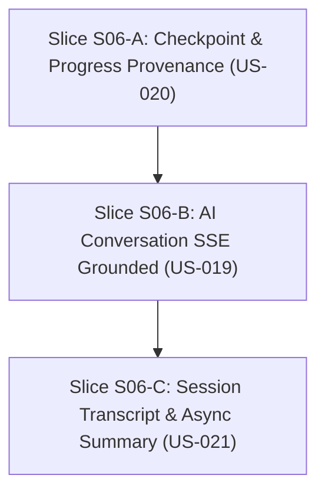

# S06 — Gói chuẩn bị mở gate: Trao đổi AI, checkpoint và resume đa thiết bị

03/11/2026 · Trạng thái: **chờ ĐẠI CA duyệt specs/stories và quyết định D-S06** · Tài liệu chuẩn bị Definition of Ready, chưa implementation.

Bám sát [S06 README](../phases/P03-classroom/sprints/S06-conversation-progress/README.md), [S06 specs](../phases/P03-classroom/sprints/S06-conversation-progress/specs.md), [SPEC-03](../specs/03-CLASSROOM-AI.md) và [WORKFLOW](../standards/WORKFLOW.md).

---

## 1. Snapshot tiến độ hiện tại (03/11/2026)

| Repo | HEAD | Trạng thái |
|---|---|---|
| **arc-academy-backend** | `0c81006` | clean, đã hoàn thành S05 (rooms, sessions, lease CAS, server grading) |
| **arc-academy-cms** | `b9ce6a0` | clean, đã hoàn thành S05 (room editor, version configuration, independent publish) |
| **arc-academy-web** | `f0a4f30` | clean, đã hoàn thành S05 (ClassroomRoom, SessionClient, speech TTS, pause/resume) |
| **backend-nestjs** (docs) | `b2096ea` | clean, S05 locally qualified, gói human sign-off sẵn sàng |

### Trạng thái các Sprint

| Sprint | Gate | Ghi chú |
|---|---|---|
| **S00** | locally qualified | Baseline specs, rules, skills |
| **S01** | locally qualified | Nền tảng 3 repo, auth/access/contracts |
| **S02** | locally qualified | Dữ liệu khoá học, bài học và tài liệu nguồn |
| **S03** | locally qualified | Giáo án và AI soạn bài |
| **S04** | **APPROVED** (30/10/2026) | Bài giảng đồ hoạ, preview và xuất bản |
| **S05** | **locally_qualified** (03/11/2026) | Gói nghiệm thu `SIGNOFF.md` chờ ĐẠI CA ký duyệt |
| **S06** | **DRAFT** | Mục tiêu: Trao đổi AI grounded, server checkpoint provenance, transcript & async summary |

---

## 2. Definition of Ready — Đối chiếu điều kiện mở S06

| Điều kiện | Trạng thái | Việc cần thực hiện |
|---|---|---|
| Dependency S05 đạt gate | **CHỜ KÝ** | ĐẠI CA xem và duyệt `SIGNOFF.md` của S05 |
| User Stories & AC chi tiết | **ĐẠT** | 3 stories US-019, US-020, US-021 (9 ACs) |
| Dữ liệu & API Contract | **ĐỀ XUẤT** | Mục 4 dưới đây chi tiết schema và giao thức SSE |
| Prompt & Grounding Strategy | **ĐỀ XUẤT** | Grounding dựa trên pinned objective và permitted source spans của bài |
| Provider / Fallback Strategy | **ĐỀ XUẤT** | Chế độ Mock AI local deterministic + Provider adapter (Gemini) |
| Quyết định chặn (D-S06) | **CHỜ CHỐT** | Mục 7 trình ĐẠI CA xem xét |

---

## 3. Phân rã User Stories và Đề xuất 3 Slices

Ước lượng effort tổng: **12–18 person-days** (theo roadmap).



### Slice S06-A: Checkpoint Grading & Progress Provenance (US-020) — 4–5 PD
- **Backend**:
  - Mở rộng chấm điểm checkpoint đa dạng (single-choice, multiple-choice, short-answer).
  - Khởi tạo bảng `LessonProgress` ghi nhận provenance (`accountId`, `lessonId`, `courseId`, `status: not_started | in_progress | completed`, `passedCheckpoints`, `firstPassedAt`, `lastAttemptAt`, `bestScore`, `sourceSessionId`).
  - Đảm bảo tính bất biến: Client không thể tự cập nhật progress; mọi tiến trình phải bắt nguồn từ kết quả server grading.
  - Idempotent deduplication cho attempt và progress update.
- **Web**:
  - Tích hợp giao diện hiển thị checkpoint quiz động theo snapshot bài giảng.
  - Phản hồi giải thích chi tiết khi đúng/sai; cập nhật thanh tiến độ buổi học.

### Slice S06-B: Hội thoại AI theo Checkpoint và Nguồn (US-019) — 5–7 PD
- **Backend**:
  - Bảng `ClassroomMessage` và `ClassroomRun` kiểm soát vòng đời tin nhắn và lượt gọi AI.
  - Endpoint SSE: `POST /api/p/v1/classroom/sessions/:id/messages` với header `Accept: text/event-stream`.
  - Luồng Stream Frames: `accepted` (kèm `runId`), `delta` (từng đoạn văn bản), `citation` (danh sách tham chiếu nguồn gồm `sourceTitle`, `sectionTitle`, `sourceSpanId`), `completed` (`messageId`), hoặc `failed` (`errorCode`, `isRetryable`).
  - Grounding Guard: Chỉ nạp context từ pinned objective, pinned checkpoint hiện tại và approved source spans trong package. Tuyệt đối không query tài liệu của course khác hoặc tài liệu chưa được cấp phép (AC-019-02).
  - Quản lý Run status: Endpoint `GET /api/p/v1/classroom/sessions/:id/runs/:runId` hỗ trợ client reconnect khi mất mạng hoặc timeout mà không gọi provider hai lần.
- **Web**:
  - Giao diện contextual chat trực tiếp trong `ClassroomRoom`.
  - Hỗ trợ Giơ tay (`Raise Hand`): Tự động tạm dừng bài giảng, mở khung hỏi đáp, hiển thị câu trả lời AI streaming kèm nguồn trích dẫn clickable.
  - Trạng thái mất mạng/reconnect: Polling trạng thái `run` để lấy lại tin nhắn trọn vẹn.

### Slice S06-C: Transcript và Summary Phiên Học (US-021) — 3–5 PD
- **Backend**:
  - Khi phiên học gọi `POST /api/p/v1/classroom/sessions/:id/finish` thành công:
    - Đánh dấu session `completed`.
    - Ghi nhận `LessonProgress` trạng thái `completed`.
    - Đẩy sự kiện `classroom.session.finished` vào `OutboxMessage`.
  - Worker xử lý `SessionSummaryWorker`:
    - Tạo `SessionSummary` (lưu `inputHash`, `promptVersion`, `strengths`, `confusionPoints`, `recommendedNextSteps`, `citations`).
    - Pin version của prompt tóm tắt; idempotent retry khi worker fail (AC-021-03).
    - Provider summary lỗi không làm mất trạng thái completion của session (AC-021-02).
  - API đọc `GET /api/p/v1/classroom/sessions/:id/summary` và `GET /api/p/v1/me/progress`.
- **CMS & Web**:
  - Web: Trang tổng kết sau khi hoàn thành buổi học (học viên xem lại điểm mạnh, điểm cần lưu ý).
  - CMS: Giao diện cho staff/mentor xem lịch sử câu hỏi và review chất lượng giải thích (AC-021-01).

---

## 4. Contract đề xuất chi tiết

### 4.1 Schema Dữ liệu Backend (Prisma)

```prisma
// Lịch sử tin nhắn trong phòng học
model ClassroomMessage {
  id                String            @id @default(uuid()) @db.Uuid
  sessionId         String            @map("session_id") @db.Uuid
  session           ClassroomSession  @relation(fields: [sessionId], references: [id], onDelete: Cascade)
  clientMessageId   String            @map("client_message_id") @db.VarChar(128)
  role              String            @db.VarChar(32) // "user" | "assistant" | "system"
  content           String            @db.Text
  checkpointId      String?           @map("checkpoint_id") @db.Uuid
  citations         Json?             // Array of { sourceId, sourceTitle, sectionTitle, excerpt }
  tokenUsage        Json?             // { promptTokens, completionTokens, totalTokens }
  createdAt         DateTime          @default(now()) @map("created_at") @db.Timestamptz

  @@unique([sessionId, clientMessageId])
  @@index([sessionId, createdAt])
  @@map("classroom_messages")
}

// Theo dõi tác vụ AI streaming chống trùng lặp
model ClassroomRun {
  id                String            @id @default(uuid()) @db.Uuid
  sessionId         String            @map("session_id") @db.Uuid
  clientRequestId   String            @map("client_request_id") @db.VarChar(128)
  status            String            @db.VarChar(32) // "queued" | "streaming" | "completed" | "failed" | "cancelled"
  modelProvider     String            @map("model_provider") @db.VarChar(64)
  promptVersion     String            @map("prompt_version") @db.VarChar(32)
  errorMessage      String?           @map("error_message") @db.Text
  createdAt         DateTime          @default(now()) @map("created_at") @db.Timestamptz
  updatedAt         DateTime          @updatedAt @map("updated_at") @db.Timestamptz

  @@unique([sessionId, clientRequestId])
  @@index([sessionId, status])
  @@map("classroom_runs")
}

// Bảng tiến độ học tập có provenance
model LessonProgress {
  id                String            @id @default(uuid()) @db.Uuid
  accountId         String            @map("account_id") @db.Uuid
  courseId          String            @map("course_id") @db.Uuid
  lessonId          String            @map("lesson_id") @db.Uuid
  status            String            @default("in_progress") @db.VarChar(32) // "in_progress" | "completed"
  passedCheckpoints Json              @default("[]") @map("passed_checkpoints") // string[] checkpointIds
  score             Int               @default(0)
  completedAt       DateTime?         @map("completed_at") @db.Timestamptz
  sourceSessionId   String            @map("source_session_id") @db.Uuid
  createdAt         DateTime          @default(now()) @map("created_at") @db.Timestamptz
  updatedAt         DateTime          @updatedAt @map("updated_at") @db.Timestamptz

  @@unique([accountId, lessonId])
  @@index([accountId, courseId])
  @@map("lesson_progresses")
}

// Bảng tóm tắt phiên học không đồng bộ
model SessionSummary {
  id                String            @id @default(uuid()) @db.Uuid
  sessionId         String            @unique @map("session_id") @db.Uuid
  session           ClassroomSession  @relation(fields: [sessionId], references: [id], onDelete: Cascade)
  inputHash         String            @map("input_hash") @db.VarChar(64)
  promptVersion     String            @map("prompt_version") @db.VarChar(32)
  status            String            @default("pending") @db.VarChar(32) // "pending" | "ready" | "failed"
  summary           String?           @db.Text
  strengths         Json?             // string[]
  confusionPoints   Json?             @map("confusion_points") // string[]
  recommendedNext   Json?             @map("recommended_next") // string[]
  citations         Json?             // array of source refs
  createdAt         DateTime          @default(now()) @map("created_at") @db.Timestamptz
  updatedAt         DateTime          @updatedAt @map("updated_at") @db.Timestamptz

  @@map("session_summaries")
}
```

### 4.2 Giao thức SSE Streaming

**Endpoint**: `POST /api/p/v1/classroom/sessions/:id/messages`  
**Headers**:
- `Accept: text/event-stream`
- `Content-Type: application/json`
- `X-Client-Request-Id: <uuid>`

**SSE Events Format**:
1. `event: accepted`  
   `data: {"runId": "...", "status": "streaming"}`
2. `event: delta`  
   `data: {"sequence": 1, "text": "Trong NestJS, "}`
3. `event: delta`  
   `data: {"sequence": 2, "text": "Guard chạy trước Interceptor và Pipe."}`
4. `event: citation`  
   `data: {"refs": [{"sourceTitle": "NestJS Request Lifecycle", "sectionTitle": "Order of execution", "sourceSpanId": "..."}]}`
5. `event: completed`  
   `data: {"messageId": "...", "runId": "...", "tokenUsage": {"totalTokens": 142}}`
6. `event: failed` (khi lỗi)  
   `data: {"errorCode": "PROVIDER_TIMEOUT", "message": "AI phản hồi chậm, vui lòng thử lại.", "isRetryable": true}`

---

## 5. Ma trận Bằng chứng Nghiệm thu (Acceptance Evidence Matrix)

| Tiêu chí | Kịch bản kiểm chứng | Lớp kiểm thử |
|---|---|---|
| **AC-019-01** | Học viên hỏi trong lúc dừng ở Checkpoint 1; AI trả lời streaming đúng kiến thức bài giảng và dẫn nguồn chính xác | Backend E2E + Web Playwright |
| **AC-019-02** | Cố tình truy vấn thông tin ngoài phạm vi hoặc tài liệu tác giả khác; AI từ chối khéo và chỉ bám nguồn được cấp phép | Backend E2E negative scope test |
| **AC-019-03** | Ngắt kết nối giữa chừng khi đang stream; gọi `GET /runs/:runId` lấy lại kết quả hoàn chỉnh, không nhân đôi message | Backend Integration test |
| **AC-020-01** | Học viên nộp đáp án đúng; server chấm đạt và cập nhật `LessonProgress` với `passedCheckpoints` chứa checkpoint đó | Backend E2E + Web Playwright |
| **AC-020-02** | Client can thiệp gửi kèm cờ `passed: true` hoặc checkpoint ID của bài học khác; server từ chối và chấm điểm độc lập | Backend E2E security test |
| **AC-020-03** | Nộp trùng lặp cùng một câu trả lời khi mất mạng; server chỉ ghi nhận 1 attempt và không tăng số lần pass | Backend E2E dedup test |
| **AC-021-01** | Hoàn thành buổi học; worker sinh summary có đầy đủ inputHash và danh sách điểm cần ôn tập | Backend Worker E2E test |
| **AC-021-02** | Giả lập Provider AI summary gặp sự cố; session vẫn kết thúc thành công, summary hiển thị lỗi rõ ràng | Backend Worker negative test |
| **AC-021-03** | Worker retry chạy lại tác vụ summary; không tạo bản ghi duplicate, pin đúng prompt version | Backend Worker idempotency test |

---

## 6. Thứ tự Triển khai Đề xuất

1. **ĐẠI CA phê duyệt Human Acceptance S05** trên `SIGNOFF.md`.
2. **ĐẠI CA phê duyệt Definition of Ready S06** và các quyết định D-S06 bên dưới.
3. **Triển khai Slice S06-A (Backend & Web)**:
   - Migration Prisma: `LessonProgress`, mở rộng chấm điểm checkpoint.
   - Endpoint chấm điểm và đồng bộ tiến độ học tập có bằng chứng.
   - Quality check 3 repo.
4. **Triển khai Slice S06-B (Backend & Web)**:
   - Migration Prisma: `ClassroomMessage`, `ClassroomRun`.
   - Streaming SSE controller với Grounding Context Filter.
   - Web Chat UI tích hợp nút Giơ tay & hiển thị trích dẫn nguồn.
   - Quality check 3 repo.
5. **Triển khai Slice S06-C (Backend & CMS/Web)**:
   - Migration Prisma: `SessionSummary`.
   - Outbox dispatcher và background worker xử lý tóm tắt.
   - Web & CMS views hiển thị kết quả và báo cáo tiến độ.
   - Real-stack acceptance sign-off đóng S06.

---

## 7. Các Quyết định cần ĐẠI CA Chốt (Blocking Decisions)

| ID | Vấn đề cần quyết định | Đề xuất của em | Lựa chọn khác |
|---|---|---|---|
| **D-S06-01** | **Chế độ AI Provider khi chạy kiểm thử local/CI** | Dùng **Deterministic Mock AI Provider** cho unit/e2e tests, hỗ trợ cờ `ARC_AI_PROVIDER=gemini` khi chạy real-key | Chỉ dùng real API key (rủi ro rate limit và chi phí) |
| **D-S06-02** | **Phạm vi nguồn tài liệu (Grounding Source Scope)** | Chỉ nạp **pinned lecture package + approved document spans** của đúng bài học đó vào context prompt | Cho phép vector search toàn khoá học (chưa cần thiết ở R1) |
| **D-S06-03** | **Giới hạn tin nhắn mỗi phiên (Quota Protection)** | Tối đa **15 lượt hỏi/đáp AI** cho mỗi session để tránh spam và vượt hạn mức | Không giới hạn / Giới hạn theo thời gian |
| **D-S06-04** | **Cơ chế tải lại khi mất kết nối stream** | Lưu từng buffer delta hoặc lưu tin nhắn hoàn chỉnh; client reconnect đọc `GET /runs/:runId` | Sử dụng WebSocket thay vì SSE (phức tạp hơn cho hạ tầng edge/serverless) |
| **D-S06-05** | **Xử lý khi AI Summary lỗi** | Đánh dấu session `completed`, summary trạng thái `failed`, cho phép bấm "Tạo lại tóm tắt" | Chặn hoàn thành bài học nếu chưa có summary (không nên, ảnh hưởng UX học viên) |
