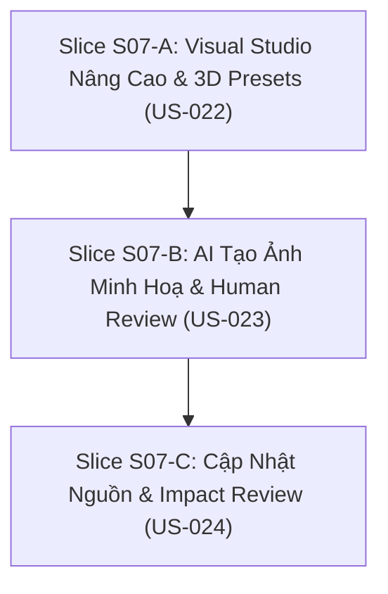

# S07 — Gói chuẩn bị mở gate: Visual studio và giáo án có vòng đời nguồn

03/11/2026 · Trạng thái: **chờ ĐẠI CA duyệt specs/stories và quyết định D-S07** · Tài liệu chuẩn bị Definition of Ready, chưa implementation.

Bám sát [S07 README](../phases/P04-core-depth/sprints/S07-visual-studio/README.md), [S07 specs](../phases/P04-core-depth/sprints/S07-visual-studio/specs.md), [SPEC-01](../specs/01-CONTENT-DOCUMENTS.md), [SPEC-02](../specs/02-GRAPHICS-LECTURES.md) và [WORKFLOW](../standards/WORKFLOW.md).

---

## 1. Snapshot tiến độ hiện tại (03/11/2026)

| Repo | HEAD | Trạng thái |
|---|---|---|
| **arc-academy-backend** | clean | Đã hoàn thành & nghiệm thu S06 (SSE streaming AI, LessonProgress, SessionSummary outbox worker) |
| **arc-academy-cms** | clean | Đã hoàn thành & nghiệm thu S06 (contracts sync, room version authoring) |
| **arc-academy-web** | clean | Đã hoàn thành & nghiệm thu S06 (ClassroomRoom Q&A panel, streaming SSE, Playwright E2E passing) |
| **backend-nestjs** (docs) | clean | S06 APPROVED (03/11/2026), gói human sign-off hoàn tất |

### Trạng thái các Sprint

| Sprint | Release / Phase | Gate | Ghi chú |
|---|---|---|---|
| **S00–S04** | R1 / P01–P02 | **APPROVED** | Nền tảng, tài liệu, giáo án, bài giảng đồ hoạ |
| **S05** | R1 / P03 | **APPROVED** (03/11/2026) | Room và engine AI 1-1, lease CAS, single writer, server grading |
| **S06** | R1 / P03 | **APPROVED** (03/11/2026) | Trao đổi AI grounded, server checkpoint provenance, transcript & async summary |
| **S07** | **R2 / P04** | **DRAFT → CHỜ MỞ GATE** | Visual studio nâng cao, AI ảnh minh hoạ có review, source impact diff & forking |

---

## 2. Definition of Ready (DoR) — Đối chiếu điều kiện mở S07

| Điều kiện | Trạng thái | Việc cần thực hiện |
|---|---|---|
| Dependency S06 đạt gate | **ĐẠT** | ĐẠI CA đã phê duyệt nghiệm thu S06 (`SIGNOFF.md` ngày 03/11/2026) |
| User Stories & AC chi tiết | **ĐẠT** | 3 stories US-022, US-023, US-024 (9 ACs) |
| Dữ liệu & API Contract | **ĐỀ XUẤT** | Mục 4 chi tiết schema VisualPreset, ImageArtifact, SourceImpact |
| AI Image & Safety Strategy | **ĐỀ XUẤT** | Phê duyệt ảnh minh hoạ qua review bắt buộc, không auto-publish chữ kỹ thuật sai |
| Source Impact Strategy | **ĐỀ XUẤT** | Impact report liệt kê package/plan/visual refs, tạo draft fork, bảo toàn citation cũ |
| Quyết định chặn (D-S07) | **CHỜ CHỐT** | Mục 7 trình ĐẠI CA xem xét |

---

## 3. Phân rã User Stories và Đề xuất 3 Slices

Ước lượng effort tổng: **12–18 person-days** (theo roadmap Release R2).



### Slice S07-A: Visual Studio Nâng Cao & 3D Presets (US-022) — 4–6 PD
- **Mục tiêu**: Nâng cấp công cụ trực quan hoá bài giảng, timeline scrub tương tác, layout focus và hỗ trợ các preset mô phỏng không gian/3D có kiểm duyệt (AC-022-01, AC-022-02, AC-022-03).
- **Backend**:
  - Model/Schema `VisualPreset`: lưu trữ định nghĩa preset chuẩn (`presetId`, `version`, `supportedRenderers`, `parametersSchema`, `fallbackKind`, `fallbackText`).
  - Validation: Đảm bảo payload của visual preset tuân thủ schema, không chứa mã JavaScript/SVG script nguy hiểm.
  - Endpoint `GET /api/i/v1/visual-presets`: tra cứu danh mục preset được duyệt.
  - Endpoint `POST /api/i/v1/visual-revisions/validate`: kiểm tra tính toàn vẹn và khả năng render.
  - Immutability check: Xuất bản visual revision mới không làm thay đổi các active classroom sessions đang pin phiên bản cũ.
- **CMS**:
  - Visual Studio Authoring UI: timeline scrubber trực quan, gắn beat tương tác với narration script.
  - Bộ chọn layout và preset (hỗ trợ preview tham số 3D preset).
  - Tích hợp tính năng preview đồng bộ với Web Renderer thông qua preview exchange token.
- **Web**:
  - Nâng cấp `VisualRenderer.tsx`: hỗ trợ hiển thị visual preset mới và timeline scrubber.
  - Accessibility & Reduced Motion: Fallback sang text semantic / static SVG khi thiết bị bật `prefers-reduced-motion` hoặc browser không hỗ trợ WebGL/3D preset.

---

### Slice S07-B: AI Tạo Ảnh Minh Hoạ Có Human Review (US-023) — 4–6 PD
- **Mục tiêu**: Quy trình tạo ảnh minh hoạ bằng AI có theo dõi nguồn gốc (provenance), quản lý ngân sách/usage và bắt buộc Human Review trước khi gắn vào bài giảng (AC-023-01, AC-023-02, AC-023-03).
- **Backend**:
  - Bảng `ImageArtifact`: lưu trữ `id`, `prompt`, `model`, `promptVersion`, `sourceDocumentRef`, `rightsOwner`, `altDraft`, `assetUrl`, `status: 'draft' | 'approved' | 'rejected'`, `rejectionReason`, `costTokens`, `costMicros`.
  - Endpoint `POST /api/i/v1/ai/image-jobs`: tiếp nhận yêu cầu sinh ảnh minh hoạ kèm quota/budget check và `Idempotency-Key`.
  - Background Job / Worker: tích hợp AI image provider (hoặc mock provider deterministic cho local/ci), xuất sinh ảnh nháp và lưu metadata bản quyền.
  - Endpoint `PATCH /api/i/v1/image-artifacts/:id/review`: Editor/Reviewer phê duyệt hoặc từ chối ảnh (chặn auto-publish nếu chữ kỹ thuật mờ/sai hoặc asset chưa sẵn sàng).
  - Endpoint `POST /api/i/v1/image-artifacts/:id/apply`: gắn ảnh đã duyệt vào visual revision cụ thể.
  - Settle Usage & Idempotency: Xử lý huỷ job hoặc retry không tính phí trùng và không cho phép gắn ảnh hai lần.
- **CMS**:
  - Panel "AI Image Generator": nhập prompt, chọn tài liệu nguồn và xem trước hạn ngạch chi phí.
  - Màn hình Human Review: hiển thị ảnh kèm metadata bản quyền, gợi ý alt-text, checklist phát hiện lỗi chính tả kỹ thuật và nút Approve / Reject with feedback.

---

### Slice S07-C: Cập Nhật Nguồn & Impact Review (US-024) — 4–6 PD
- **Mục tiêu**: Cơ chế thông báo và phân tích tác động (Impact Analysis) khi tài liệu nguồn gốc có phiên bản mới, cho phép tạo bản nháp nhánh (draft fork) mà không ảnh hưởng bài giảng đang chạy (AC-024-01, AC-024-02, AC-024-03).
- **Backend**:
  - Endpoint `GET /api/i/v1/document-revisions/:id/impact`: phân tích toàn bộ các `LecturePackage`, `TeachingPlanRevision`, `VisualRevision` đang trỏ tới tài liệu này hoặc các bản sửa đổi trước đó.
  - Endpoint `POST /api/i/v1/teaching-plans/fork-revision`: tạo bản nháp giáo án mới (draft fork) cập nhật theo document revision mới nhất.
  - Extraction Gate: Chặn tái tạo giáo án tự động nếu document revision mới chưa hoàn tất trích xuất (`status !== 'ready'`). Hỗ trợ tuỳ chọn giữ nguồn cũ rõ ràng.
  - Immutability & Citation Preservation: Các phiên học cũ (`ClassroomSession`) tiếp tục trích xuất và tham chiếu đúng tài liệu nguồn cũ đã pin, không bị viết lại lịch sử (no history rewriting).
- **CMS**:
  - Màn hình "Source Impact Analysis": hiển thị bảng so sánh phiên bản tài liệu nguồn, danh sách bài học và slide bị ảnh hưởng, kèm độ nghiêm trọng (breaking / additive).
  - Nút "Fork Draft with Updated Source": tạo phiên bản nháp độc lập cho giảng viên rà soát lại trước khi xuất bản.

---

## 4. Đặc tả Dữ liệu và Semantic Contracts

### 4.1. Visual Preset Schema (`VisualPreset`)
```typescript
export interface VisualPreset {
  id: string;
  name: string;
  version: string; // e.g. "preset-3d-arch-v1"
  rendererVersion: string; // "arc-visual-1"
  category: 'architecture' | 'flow' | 'memory-model' | 'network-topology';
  parametersSchema: Record<string, unknown>; // JSON Schema cho các tham số đầu vào
  fallbackKind: 'text-slide' | 'flow' | 'worked-example';
  fallbackTemplate: {
    title: string;
    description: string;
    bullets?: string[];
  };
  status: 'active' | 'deprecated';
}
```

### 4.2. Image Artifact Schema (`ImageArtifact`)
```typescript
export interface ImageArtifact {
  id: string;
  prompt: string;
  promptVersion: string;
  model: string;
  sourceDocumentRef: {
    documentId: string;
    revisionId: string;
    spanId?: string;
  };
  rights: {
    license: 'internal_authored' | 'ai_generated_approved' | 'cc_by_4_0';
    attribution: string;
  };
  altDraft: string;
  mediaAssetId?: string;
  status: 'draft' | 'approved' | 'rejected';
  rejectionReason?: string;
  technicalAccuracyConfirmed: boolean;
  costTokens: number;
  costMicros: number;
  appliedVisualRevisionId?: string;
  createdAt: string;
  reviewedAt?: string;
  reviewedBy?: string;
}
```

### 4.3. Source Impact DTO (`SourceImpact`)
```typescript
export interface SourceImpactResponse {
  documentId: string;
  sourceRevisionId: string;
  targetRevisionId: string;
  extractionStatus: 'pending' | 'ready' | 'failed';
  affectedPackages: Array<{
    packageId: string;
    courseId: string;
    lessonId: string;
    lessonTitle: string;
    status: 'draft' | 'published';
    citedSpansCount: number;
    staleSpansCount: number;
  }>;
  affectedPlans: Array<{
    planRevisionId: string;
    lessonId: string;
    sourceRefsCount: number;
  }>;
  affectedVisuals: Array<{
    visualRevisionId: string;
    lessonId: string;
    sourceRefsCount: number;
  }>;
  suggestedAction: 'fork_draft' | 'wait_extraction' | 'no_impact';
}
```

---

## 5. Kế hoạch Kiểm thử & Bằng chứng Nghiệm thu

Mỗi User Story đi kèm bộ tiêu chí nghiệm thu tự động (AC ID):
1. **US-022**:
   - `AC-022-01`: CMS và Web cùng render `rendererVersion` và semantic content khi scrub/edit preview.
   - `AC-022-02`: Thiết bị reduced-motion hoặc preset thiếu hỗ trợ tự động fallback hiển thị văn bản semantic.
   - `AC-022-03`: Xuất bản visual revision mới không sửa đổi active session snapshot của phiên học đang diễn ra.
2. **US-023**:
   - `AC-023-01`: Sinh ảnh có prompt, model, source document ref, rights và alt draft hợp lệ.
   - `AC-023-02`: Ảnh có lỗi kỹ thuật hoặc chưa ready không được xuất bản; yêu cầu reject hoặc sửa.
   - `AC-023-03`: Huỷ/retry job sau khi provider tính phí không tạo bản apply trùng hay miễn phí bất thường.
3. **US-024**:
   - `AC-024-01`: Revision mới hiển thị đầy đủ danh sách package/plan/visual refs bị ảnh hưởng và hỗ trợ tạo draft fork.
   - `AC-024-02`: Chặn sinh giáo án nếu revision mới chưa hoàn tất trích xuất ready.
   - `AC-024-03`: Active session đang pin nguồn cũ vẫn tra cứu citation cũ chính xác, không rewrite history.

---

## 6. Ma trận Phân quyền & Endpoint Mới

| Endpoint | Method | Vai trò tối thiểu | Mục đích |
|---|---|---|---|
| `/api/i/v1/visual-presets` | GET | `editor` / `reviewer` | Tra cứu preset 3D/đồ hoạ được phê chuẩn |
| `/api/i/v1/visual-presets` | POST | `admin` | Đăng ký preset đồ hoạ mới |
| `/api/i/v1/ai/image-jobs` | POST | `editor` | Tạo job sinh ảnh AI gắn tài liệu nguồn |
| `/api/i/v1/image-artifacts/:id` | GET | `editor` / `reviewer` | Lấy chi tiết và trạng thái của ảnh minh hoạ |
| `/api/i/v1/image-artifacts/:id/review` | PATCH | `reviewer` | Phê duyệt hoặc từ chối ảnh minh hoạ nháp |
| `/api/i/v1/image-artifacts/:id/apply` | POST | `editor` | Gắn ảnh đã duyệt vào visual revision nháp |
| `/api/i/v1/document-revisions/:id/impact` | GET | `editor` / `reviewer` | Tính toán ma trận tác động khi tài liệu cập nhật |
| `/api/i/v1/teaching-plans/fork-revision` | POST | `editor` | Tạo draft fork giáo án với tài liệu nguồn mới |

---

## 7. Các Quyết định Chặn trình ĐẠI CA (D-S07)

- **D-S07-1 (AI Image Provider)**:
  - *Phương án A (Khuyến nghị)*: Triển khai Adapter linh hoạt với chế độ deterministic Mock cho Local Test / CI, và kết nối Imagen 3 / Gemini Image Generation khi có API key.
  - *Phương án B*: Chỉ dùng external API thật (yêu cầu cấu hình credentials ngay).
  - *Đề xuất*: Chọn **Phương án A** để đảm bảo 100% test suite tự động và CI luôn chạy độc lập không phụ thuộc mạng ngoài.
- **D-S07-2 (3D Presets Engine)**:
  - *Phương án A (Khuyến nghị)*: Tận dụng các component SVG/Canvas chuẩn và WebGL lightweight declarative presets tích hợp sẵn trong Web `VisualRenderer`, có kiểm soát chặt chẽ qua schema JSON; tuyệt đối không cho phép upload file nhị phân bundle code tuỳ ý.
  - *Phương án B*: Cho phép upload bundle iframe (rủi ro bảo mật XSS và khó kiểm soát version parity).
  - *Đề xuất*: Chọn **Phương án A** bám sát invariant của `SPEC-02`.
- **D-S07-3 (Impact Forking Strategy)**:
  - *Phương án A (Khuyến nghị)*: Explicit Forking — khi nguồn có revision mới, hệ thống chỉ cảnh báo và cho phép Editor chủ động bấm nút "Fork Draft", bảo toàn 100% các phiên bản published đang chạy.
  - *Phương án B*: Auto-fork ngầm trong nền.
  - *Đề xuất*: Chọn **Phương án A** bám sát triết lý bất biến (immutability) của kiến trúc.

---

## 8. Trạng thái Sẵn sàng mở Gate S07

Dự án đã sẵn sàng mở Gate triển khai Sprint S07 ngay khi ĐẠI CA phê duyệt gói DoR này.
Mọi chi tiết specs, stories, criteria đã được đồng bộ chuẩn mực.
