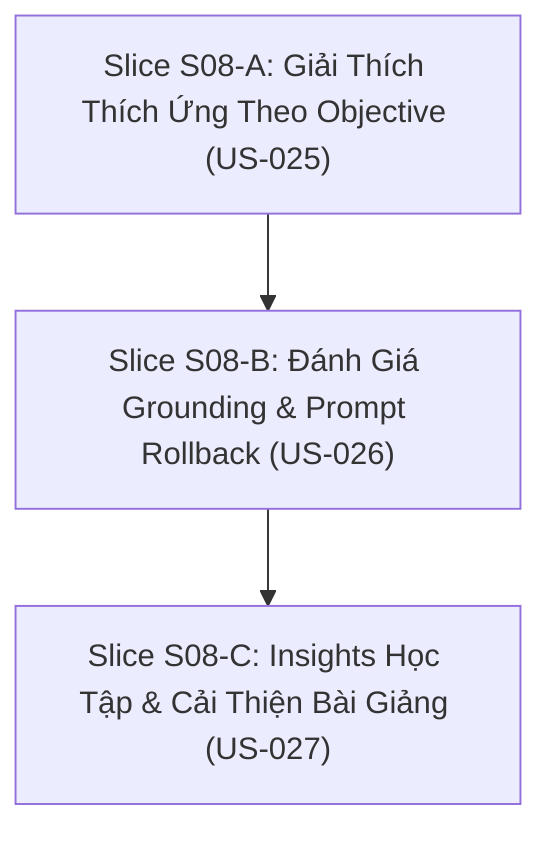

# S08 — Gói chuẩn bị mở gate: Giải thích thích ứng và phân tích phiên học

03/11/2026 · Trạng thái: **SẴN SÀNG TRIỂN KHAI (Gate Opening S08)** · Tài liệu Definition of Ready và kế hoạch kỹ thuật.

Bám sát [S08 README](../phases/P04-core-depth/sprints/S08-adaptive-teaching/README.md), [S08 specs](../phases/P04-core-depth/sprints/S08-adaptive-teaching/specs.md), [SPEC-03](../specs/03-CLASSROOM-AI.md) và [WORKFLOW](../standards/WORKFLOW.md).

---

## 1. Snapshot tiến độ hiện tại (03/11/2026)

| Repo | HEAD | Trạng thái |
|---|---|---|
| **arc-academy-backend** | clean | Đã hoàn thành & nghiệm thu S07 (Preset3D catalog, AI Image jobs/artifacts review gate, Document impact analysis & fork revision, 148 tests / 138 Bruno smoke passing) |
| **arc-academy-cms** | clean | Đã hoàn thành & nghiệm thu S07 (Visual Studio 3D presets, AiImageStudio with technical accuracy confirmation checklist, SourceImpactDialog with fork draft, 72 tests / 970 strings passing) |
| **arc-academy-web** | clean | Đã hoàn thành & nghiệm thu S07 (Preset3DView with semantic fallback for reduced motion, interactive narration timeline scrubber, 58 tests / 324 strings passing) |
| **backend-nestjs** (docs) | clean | S07 APPROVED (03/11/2026), hồ sơ nghiệm thu đầy đủ, indices đã cập nhật |

### Trạng thái các Sprint

| Sprint | Release / Phase | Gate | Ghi chú |
|---|---|---|---|
| **S00–S04** | R1 / P01–P02 | **APPROVED** | Nền tảng, tài liệu, giáo án, bài giảng đồ hoạ |
| **S05** | R1 / P03 | **APPROVED** (03/11/2026) | Room và engine AI 1-1, lease CAS, single writer, server grading |
| **S06** | R1 / P03 | **APPROVED** (03/11/2026) | Trao đổi AI grounded, server checkpoint provenance, transcript & async summary |
| **S07** | R2 / P04 | **APPROVED** (03/11/2026) | Visual studio nâng cao, AI ảnh minh hoạ có review, source impact diff & forking |
| **S08** | **R2 / P04** | **IN PROGRESS (GATE OPENED)** | Giải thích thích ứng theo objective, đánh giá grounding & prompt rollback, insights học tập |

---

## 2. Definition of Ready (DoR) — Đối chiếu điều kiện mở S08

| Điều kiện | Trạng thái | Việc thực hiện |
|---|---|---|
| Dependency S07 đạt gate | **ĐẠT** | ĐẠI CA đã phê duyệt nghiệm thu S07 (`SIGNOFF.md` ngày 03/11/2026) |
| User Stories & AC chi tiết | **ĐẠT** | 3 stories US-025, US-026, US-027 (9 ACs) |
| Dữ liệu & API Contract | **ĐẠT** | Mục 4 chi tiết schema ExplanationRun, GroundingEvaluation, PromptRegistry, LearningInsight |
| Invariant bảo toàn kiến trúc | **ĐẠT** | Không sửa published teaching plan, không tự pass checkpoint, không leak transcript học viên, không sinh citation giả mạo |
| Immutability & Rollback Strategy | **ĐẠT** | Run cũ bảo toàn prompt version cũ, run mới trỏ về active version đã rollback |

---

## 3. Phân rã User Stories và Đề xuất 3 Slices

Ước lượng effort tổng: **12–18 person-days** (theo roadmap Release R2).



### Slice S08-A: Giải Thích Thích Ứng Theo Objective (US-025) — 4–6 PD
- **Mục tiêu**: Khi học viên chưa hiểu ở một checkpoint, hệ thống cho phép kích hoạt giải thích thích ứng dựa trên objective đã duyệt và schema đồ hoạ trực quan, đưa câu hỏi kiểm tra độ hiểu (check-understanding), đồng thời bảo toàn beat gốc khi quay lại bài giảng (AC-025-01, AC-025-02, AC-025-03).
- **Backend**:
  - Endpoint `POST /api/p/v1/classroom/sessions/:id/explanations`: tiếp nhận yêu cầu giải thích phụ gắn với `checkpointId` và `objectiveId`.
  - Service logic:
    - Trích xuất context từ pinned `snapshot` (objective title, description, permitted source spans, visual schema).
    - Sinh nội dung giải thích thay thế (text / analogy / concrete example) + câu hỏi check-understanding (`question`, `sampleAnswerPrompt`).
    - Gắn citations có kiểm tra tính xác thực nguồn.
    - **Bất biến**: Tuyệt đối không thay đổi published teaching plan / package, không tự động đánh dấu `passed` cho checkpoint attempt.
    - Trả về `resumedBeatId` trỏ về đúng beat/checkpoint của bài giảng gốc.
- **Web**:
  - Tích hợp nút "Yêu cầu giải thích khác" trên thanh điều khiển hoặc Q&A panel khi phiên học đang tạm dừng hoặc học viên dừng tại checkpoint.
  - Hiển thị Adaptive Explanation Card: giải thích tương ứng, minh hoạ bổ trợ, câu hỏi check-understanding, nguồn trích dẫn và nút "Tiếp tục bài giảng" đưa người học trở lại đúng vị trí beat bài giảng gốc.
- **CMS**:
  - Cho phép xem trước danh mục các hình thức giải thích thích ứng (analogy, step-by-step, visual diagram) được định nghĩa trong teaching plan.

---

### Slice S08-B: Đánh Giá Grounding & Prompt Rollback (US-026) — 4–6 PD
- **Mục tiêu**: Reviewer có công cụ đánh giá mức độ groundedness và độ nghiêm trọng của câu trả lời AI theo tài liệu nguồn, tự động phát hiện trích dẫn sai revision / không resolve để chặn expose nguồn giả; hỗ trợ rollback phiên bản prompt về phiên bản ổn định đã duyệt (AC-026-01, AC-026-02, AC-026-03).
- **Backend**:
  - Model/Bảng `AiGroundingEvaluation`: lưu trữ kết quả đánh giá (`id`, `objectiveId`, `sourceDocumentRevisionId`, `query`, `answer`, `groundednessScore`, `severity: 'low' | 'medium' | 'high'`, `findings: Json`, `status: 'valid' | 'flagged' | 'rejected'`).
  - Endpoint `POST /api/i/v1/ai/evaluations/grounding`: thẩm định câu trả lời dựa trên objective và tài liệu nguồn. Kiểm tra từng citation span ID và revision ID đối chiếu với database thực.
    - Nếu citation trỏ sai revision hoặc spanId không tồn tại: flag severity `high`, `status: 'rejected'`, lỗi `unresolvable_citation` hoặc `revision_mismatch`, tuyệt đối không expose nguồn giả.
  - Endpoint `GET /api/i/v1/ai/prompt-registry`: tra cứu danh mục prompt template và phiên bản active hiện tại.
  - Endpoint `POST /api/i/v1/ai/prompt-registry/rollback`: rollback con trỏ active prompt version về phiên bản trước.
    - **Bất biến**: Các `ClassroomRun` và `ClassroomMessage` đã sinh trước đó giữ nguyên `promptVersion` lịch sử, các run mới sẽ sử dụng phiên bản vừa rollback.
- **CMS**:
  - Màn hình "Grounding & Trích dẫn Review": nhập fixture hoặc chọn câu trả lời AI để kiểm tra groundedness, xem danh sách vi phạm và trạng thái resolve của citations.
  - Bảng quản lý Prompt Version & Rollback: hiển thị danh sách các phiên bản prompt, changelog, nút "Rollback về phiên bản này" kèm xác nhận an toàn.

---

### Slice S08-C: Insights Học Tập & Cải Thiện Bài Giảng (US-027) — 4–6 PD
- **Mục tiêu**: Tổng hợp phân tích học tập theo objective và checkpoint (số câu hỏi, điểm tắc/ngộ nhận, tỷ lệ dừng bài) để trợ giảng/mentor và biên tập viên cải thiện giáo án; bảo vệ quyền riêng tư học viên (không leak transcript cá nhân khi mẫu nhỏ) và chống đếm lặp qua cơ chế projection idempotent (AC-027-01, AC-027-02, AC-027-03).
- **Backend**:
  - Model/Bảng `LearningInsightProjection`: lưu trữ số liệu thống kê tổng hợp theo bài học (`lessonId`, `checkpointId`, `objectiveId`, `totalSessions`, `questionCount`, `dropoffCount`, `confusionPoints: Json`, `insufficientEvidence: Boolean`, `lastEventSequence`, `updatedAt`).
  - Endpoint `GET /api/i/v1/learning-insights/lessons/:lessonId`: tra cứu insight tổng hợp cho bài học theo phạm vi quyền.
    - **Bảo mật & K-Anonymity**: Nếu số lượng phiên học quá ít (`< 3 sessions`) hoặc actor không đủ scope được gán: gắn cờ `insufficientEvidence: true`, từ chối kết luận suy diễn và tuyệt đối không trả về transcript raw hay danh tính học viên.
  - Endpoint `POST /api/i/v1/learning-insights/rebuild-projection`: tính toán lại projection từ session events và session summaries với cơ chế deduplication theo `(sessionId, eventId)` chống đếm lặp (idempotent).
- **CMS**:
  - Màn hình "Insights học tập bài giảng":
    - Biểu đồ câu hỏi và điểm tắc theo từng objective/checkpoint.
    - Danh sách các ngộ nhận phổ biến (confusion points) được tổng hợp tự động.
    - Banner cảnh báo "Dữ liệu chưa đủ bằng chứng" khi số mẫu học viên dưới ngưỡng an toàn.

---

## 4. Đặc tả Dữ liệu và Semantic Contracts

### 4.1. Adaptive Explanation Contract (`SessionExplanation`)

```typescript
export interface SessionExplanationRequestDto {
  checkpointId: string;
  objectiveId: string;
  clientRequestId: string;
  preferredModality?: 'text' | 'analog' | 'concrete_example';
}

export interface SessionExplanationViewDto {
  runId: string;
  sessionId: string;
  objectiveId: string;
  checkpointId: string;
  explanation: string;
  visualAnalog?: {
    kind: string;
    title: string;
    data: Record<string, unknown>;
  };
  checkUnderstanding: {
    question: string;
    sampleAnswerPrompt?: string;
  };
  citations: Array<{
    sourceId: string;
    sourceTitle: string;
    sectionTitle: string;
    excerpt: string;
    sourceSpanId?: string;
  }>;
  resumedBeatId: string | null;
  createdAt: string;
}
```

### 4.2. Grounding Evaluation & Prompt Rollback Contract

```typescript
export interface GroundingEvaluationRequestDto {
  objectiveId: string;
  sourceRevisionId: string;
  query: string;
  answer: string;
  claimedCitations: Array<{
    sourceRevisionId: string;
    spanId: string;
    excerpt?: string;
  }>;
}

export interface GroundingEvaluationResultDto {
  id: string;
  objectiveId: string;
  groundednessScore: number; // 0 - 100
  severity: 'low' | 'medium' | 'high';
  status: 'valid' | 'flagged' | 'rejected';
  findings: Array<{
    code: string; // e.g. 'unresolvable_citation' | 'revision_mismatch' | 'hallucination'
    severity: 'low' | 'medium' | 'high';
    message: string;
    evidenceRef?: string;
  }>;
  evaluatedAt: string;
}

export interface PromptRegistryViewDto {
  promptKey: string;
  activeVersion: string;
  versions: Array<{
    version: string;
    description: string;
    isActive: boolean;
    approvedBy: string;
    updatedAt: string;
  }>;
}

export interface PromptRollbackRequestDto {
  promptKey: string;
  targetVersion: string;
  reason: string;
}
```

### 4.3. Learning Insights Contract

```typescript
export interface LearningInsightViewDto {
  lessonId: string;
  totalSessions: number;
  insufficientEvidence: boolean;
  objectiveInsights: Array<{
    objectiveId: string;
    objectiveTitle: string;
    questionCount: number;
    dropoffCount: number;
    dropoffRate: number;
    topConfusionPoints: string[];
  }>;
  checkpointStats: Array<{
    checkpointId: string;
    attemptCount: number;
    passRate: number;
  }>;
  lastRebuiltAt: string;
}
```

---

## 5. Kế hoạch Kiểm thử & Bằng chứng Nghiệm thu

Mỗi User Story đi kèm bộ tiêu chí nghiệm thu tự động (AC ID):
1. **US-025**:
   - `AC-025-01`: Given checkpoint đang học và source được phép; When yêu cầu giải thích khác; Then AI dùng approved objective/visual schema và đưa check-understanding.
   - `AC-025-02`: Given AI muốn tự thay plan/pass checkpoint; When trả adaptive response; Then không sửa published package hoặc tự pass.
   - `AC-025-03`: Given kết thúc trao đổi phụ; When resume lecture; Then quay lại beat gốc đúng version.
2. **US-026**:
   - `AC-026-01`: Given fixture objective/source/answer có kỳ vọng; When chạy review evaluation; Then findings groundedness và severity có evidence refs.
   - `AC-026-02`: Given citation sai revision hoặc không resolve; When validate answer; Then flag/reject, không expose nguồn giả.
   - `AC-026-03`: Given prompt mới chất lượng giảm; When rollback active pointer; Then run cũ giữ version, run mới dùng version đã duyệt.
3. **US-027**:
   - `AC-027-01`: Given có sessions được cấp scope; When mở insights; Then aggregate questions/dropoff/summary theo objective.
   - `AC-027-02`: Given ít dữ liệu hoặc actor ngoài scope; When query analytics; Then không khẳng định kết quả học chưa có bằng chứng, không leak transcript.
   - `AC-027-03`: Given event dedup/reprocess; When rebuild projection; Then insight không đếm trùng hoặc đổi nguồn lịch sử.

---

## 6. Ma trận Phân quyền & Endpoint Mới

| Endpoint | Method | Vai trò tối thiểu | Quyền kiểm tra | Mục đích |
|---|---|---|---|---|
| `/api/p/v1/classroom/sessions/:id/explanations` | POST | `student` | `classroom:session:read-self` | Yêu cầu giải thích thích ứng theo checkpoint |
| `/api/i/v1/ai/evaluations/grounding` | POST | `content_reviewer` | `content:lesson:review` | Đánh giá groundedness và phát hiện citation giả |
| `/api/i/v1/ai/prompt-registry` | GET | `content_reviewer` | `content:lesson:review` | Tra cứu danh mục version prompt |
| `/api/i/v1/ai/prompt-registry/rollback` | POST | `admin` | `platform:ai:configure` | Rollback con trỏ active prompt sang bản cũ |
| `/api/i/v1/learning-insights/lessons/:lessonId` | GET | `mentor` / `reviewer` | `classroom:session:read-assigned` hoặc `content:lesson:read` | Tra cứu insights học tập tổng hợp theo objective |
| `/api/i/v1/learning-insights/rebuild-projection` | POST | `admin` | `platform:ai:configure` | Tái tính toán projection insight chống trùng lặp |

---

## 7. Các Quyết định Kỹ thuật Chốt cho S08

- **D-S08-1 (Adaptive Explanation Isolation)**:
  - Giải thích thích ứng chạy độc lập trong phạm vi session con; tuyệt đối không ghi đè cấu trúc `snapshot.lecture` của `ClassroomSession`. Checkpoint chỉ được tính là passed khi học viên gửi submission qua endpoint `/attempts` và vượt qua server validation.
- **D-S08-2 (Citation Integrity Guarantee)**:
  - Mọi citation được trả về bắt buộc đối chiếu với `DocumentRevision` và `DocumentSpan` trong database. Nếu citation trỏ đến revision chưa sẵn sàng (`status !== 'ready'`) hoặc không khớp văn bản nguồn, request review đánh dấu `status: 'rejected'` với mức nghiêm trọng `high` để reviewer loại bỏ.
- **D-S08-3 (Privacy-First Insights Aggregation)**:
  - Ngưỡng K-Anonymity tối thiểu là 3 sessions. Nếu bài học có ít hơn 3 học viên hoàn thành hoặc tham gia, hệ thống bật cờ `insufficientEvidence: true`, ẩn chi tiết trích dẫn ngộ nhận và cảnh báo dữ liệu chưa đủ độ tin cậy.

---

## 8. Kết luận

Gate Sprint S08 chính thức mở. Toàn bộ thiết kế dữ liệu, phân quyền, API contracts và kịch bản nghiệm thu tự động đã sẵn sàng để triển khai song song trên cả 3 repos (`arc-academy-backend`, `arc-academy-cms`, `arc-academy-web`).
