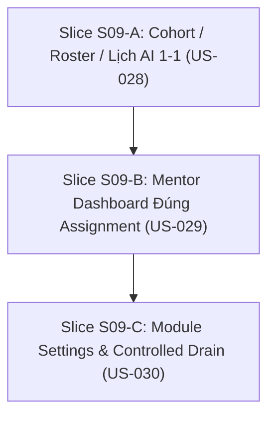

# S09 — Gói chuẩn bị mở gate: Lớp, lịch và mentor theo dõi 1-1

04/11/2026 · Trạng thái: **SẴN SÀNG TRIỂN KHAI (Gate Opening S09)** · Tài liệu Definition of Ready và kế hoạch kỹ thuật.

Bám sát [S09 README](../phases/P04-core-depth/sprints/S09-cohorts-mentor/README.md), [S09 specs](../phases/P04-core-depth/sprints/S09-cohorts-mentor/specs.md), [SPEC-03](../specs/03-CLASSROOM-AI.md), [SPEC-04](../specs/04-PLATFORM-CONTRACTS.md) và [WORKFLOW](../standards/WORKFLOW.md).

---

## 1. Snapshot tiến độ hiện tại (04/11/2026)

| Repo | HEAD | Trạng thái |
|---|---|---|
| **arc-academy-backend** | clean | Đã hoàn thành & nghiệm thu S08 (Adaptive Explanation, Grounding Evaluation & Prompt Rollback, Learning Insights & K-anonymity gate, 151 tests / 144 Bruno smoke passing) |
| **arc-academy-cms** | clean | Đã hoàn thành & nghiệm thu S08 (Grounding & Prompt Registry panel with rollback, Learning Insights analytics panel with K-anonymity gate, 72 tests / 986 strings passing) |
| **arc-academy-web** | clean | Đã hoàn thành & nghiệm thu S08 (Adaptive Explanation modal/card with visual analog preview, check-understanding prompt, clean beat resume, 58 tests / 331 strings passing) |
| **backend-nestjs** (docs) | clean | S08 APPROVED (04/11/2026), hồ sơ nghiệm thu đầy đủ, indices đã cập nhật |

### Trạng thái các Sprint

| Sprint | Release / Phase | Gate | Ghi chú |
|---|---|---|---|
| **S00–S04** | R1 / P01–P02 | **APPROVED** | Nền tảng, tài liệu, giáo án, bài giảng đồ hoạ |
| **S05** | R1 / P03 | **APPROVED** | Room và engine AI 1-1, lease CAS, single writer, server grading |
| **S06** | R1 / P03 | **APPROVED** | Trao đổi AI grounded, server checkpoint provenance, transcript & async summary |
| **S07** | R2 / P04 | **APPROVED** | Visual studio nâng cao, AI ảnh minh hoạ có review, source impact diff & forking |
| **S08** | R2 / P04 | **APPROVED** (04/11/2026) | Giải thích thích ứng theo objective, đánh giá grounding & prompt rollback, insights học tập |
| **S09** | **R2 / P04** | **IN PROGRESS (GATE OPENED)** | Lớp, lịch và mentor theo dõi 1-1, cohort roster, module settings & controlled drain |

---

## 2. Definition of Ready (DoR) — Đối chiếu điều kiện mở S09

| Điều kiện | Trạng thái | Việc thực hiện |
|---|---|---|
| Dependency S06, S08 đạt gate | **ĐẠT** | ĐẠI CA đã phê duyệt nghiệm thu S06 và S08 (`SIGNOFF.md` ngày 04/11/2026) |
| User Stories & AC chi tiết | **ĐẠT** | 3 stories US-028, US-029, US-030 (9 ACs) |
| Dữ liệu & API Contract | **ĐẠT** | Schema CohortClass, ClassRoster, ClassOccurrence, StudentNotification, ModuleInstallation |
| Invariant bảo toàn kiến trúc | **ĐẠT** | Duy nhất 1 primary session / student / occurrence; không shared AV; reschedule/cancel không rewrite lịch sử session cũ; mentor chỉ xem đúng assignment; transcript có audit bắt buộc; cấm disable core auth/audit |
| Drain & Maintenance Strategy | **ĐẠT** | Classroom module drain: chặn new session, duy trì in-flight sessions có deadline audit |

---

## 3. Phân rã User Stories và 3 Slices Triển Khai

Ước lượng effort tổng: **10–16 person-days** (theo roadmap Release R2).

### Slice S09-A: Cohort / Roster / Lịch AI 1-1 (US-028) — 4–6 PD
- **Mục tiêu**: Tổ chức lớp học, import roster CSV, lập lịch học với startUTC/endUTC và IANA timezone; mỗi học viên tham gia phiên 1-1 độc lập, không shared AV, duy nhất một primary session per student per occurrence; hỗ trợ reschedule/cancel không rewrite lịch sử; nhắc lịch in-app dedup (AC-028-01, AC-028-02, AC-028-03).
- **Backend**:
  - Prisma Models:
    - `CohortClass`: `id`, `courseId`, `title`, `description`, `mentorId`, `status` (`draft`, `active`, `archived`), `createdAt`, `updatedAt`.
    - `ClassRoster`: `id`, `classId`, `studentId`, `status` (`enrolled`, `dropped`), `effectiveFrom`, `effectiveTo`, `createdAt`. Unique `(classId, studentId)`.
    - `ClassOccurrence`: `id`, `classId`, `roomId`, `title`, `startUtc`, `endUtc`, `timezone`, `status` (`scheduled`, `rescheduled`, `cancelled`, `completed`), `scheduleVersion`, `createdAt`, `updatedAt`.
    - `StudentNotification`: `id`, `accountId`, `type`, `title`, `body`, `dedupKey`, `readAt`, `metadata`, `createdAt`. Unique `(accountId, dedupKey)`.
    - Cập nhật `ClassroomSession`: Thêm trường `occurrenceId String?` và unique constraint logic / validation đảm bảo duy nhất 1 primary session cho mỗi `(accountId, occurrenceId)`.
  - Endpoints:
    - Internal:
      - `POST /api/i/v1/cohorts/classes`: Tạo lớp học (`classroom:class:write`).
      - `GET /api/i/v1/cohorts/classes`: Danh sách lớp học (`classroom:class:read`).
      - `POST /api/i/v1/cohorts/classes/:id/roster`: Thêm học viên vào lớp.
      - `POST /api/i/v1/cohorts/classes/:id/roster/csv`: Import học viên từ CSV (phát hiện trùng lặp, trả report chi tiết).
      - `POST /api/i/v1/cohorts/classes/:id/occurrences`: Tạo buổi học theo lịch (startUTC, endUTC, timezone).
      - `POST /api/i/v1/cohorts/occurrences/:id/reschedule`: Đổi lịch buổi học (tăng scheduleVersion, sinh notification, không sửa session cũ).
      - `POST /api/i/v1/cohorts/occurrences/:id/cancel`: Hủy buổi học (giữ nguyên session cũ nếu đã có, sinh notification).
    - Public:
      - `GET /api/p/v1/me/classes`: Danh sách lớp học viên đã tham gia (`classroom:session:read-self`).
      - `GET /api/p/v1/me/schedule`: Danh sách các buổi học (occurrences) sắp tới và đã qua.
      - `POST /api/p/v1/classroom/sessions`: Hỗ trợ tham số `occurrenceId`. Kiểm tra học viên thuộc roster và trong join window; đảm bảo duy nhất 1 primary session per student.
      - `GET /api/p/v1/me/notifications`: Danh sách thông báo nhắc lịch của học viên.
      - `PATCH /api/p/v1/me/notifications/:id/read`: Đánh dấu đã đọc.
- **CMS**:
  - Giao diện quản lý Lớp học: danh sách lớp, tạo lớp, gắn mentor.
  - Quản lý Roster: import CSV học viên, hiển thị lỗi trùng lặp hoặc invalid email.
  - Quản lý Lịch: tạo buổi học, hiển thị múi giờ, nút Reschedule và Cancel kèm lý do.
- **Web**:
  - Giao diện "Lớp học của tôi" và "Lịch học": hiển thị occurrences theo múi giờ địa phương của học viên.
  - Nút "Vào phòng học 1-1": tạo hoặc tiếp tục session cá nhân tương ứng với occurrence.
  - Trung tâm thông báo (In-app notifications): nhắc lịch học, thông báo đổi lịch, không bị duplicate.

---

### Slice S09-B: Mentor Dashboard Đúng Assignment (US-029) — 3–5 PD
- **Mục tiêu**: Mentor được gán lớp chỉ xem tiến độ và tóm tắt học viên trong phạm vi lớp được giao; xem transcript có quyền riêng (`classroom:transcript:read`) và audit log bắt buộc; thu hồi assignment chặn truy vấn ngay lập tức; query key đúng scope không lẫn account cache (AC-029-01, AC-029-02, AC-029-03).
- **Backend**:
  - Logic xác thực phân quyền mentor:
    - Khi mentor truy vấn: kiểm tra `CohortClass.mentorId === actorId` (hoặc actor có quyền admin `classroom:mentor:read-all`).
    - Nếu assignment bị thu hồi: trả về `403 Forbidden` ngay lập tức.
  - Endpoints:
    - Internal:
      - `GET /api/i/v1/mentor/classes`: Danh sách các lớp được phân công cho mentor.
      - `GET /api/i/v1/mentor/classes/:classId/progress`: Tiến độ và checkpoint mastery của từng học viên trong lớp.
      - `GET /api/i/v1/mentor/classes/:classId/sessions/:sessionId/summary`: Xem AI summary của phiên học.
      - `GET /api/i/v1/mentor/classes/:classId/sessions/:sessionId/transcript`: Xem transcript phiên học (Yêu cầu quyền `classroom:transcript:read`, ghi bản ghi vào `AuditLog` với `action: "read_transcript"`).
- **CMS**:
  - Mentor Dashboard:
    - Bảng danh sách lớp được giao phụ trách.
    - Bộ lọc học viên và bảng tiến độ theo từng buổi học.
    - Modal / drawer xem AI summary và transcript học viên (có cảnh báo bảo mật quyền riêng tư).
    - Query keys của React Query tách biệt theo `['mentor', classId, studentId]` để đảm bảo cache không bị lẫn khi chuyển đổi lớp hoặc học viên.

---

### Slice S09-C: Module Settings & Controlled Drain (US-030) — 3–5 PD
- **Mục tiêu**: Quản lý cấu hình module có kiểm tra phiên bản và tính toàn vẹn phụ thuộc; cấm vô hiệu hoá core auth/audit; cơ chế disable drain có kiểm soát: chặn tạo session mới, cho phép session đang chạy kết thúc hoặc dừng theo deadline policy có audit (AC-030-01, AC-030-02, AC-030-03).
- **Backend**:
  - Dữ liệu `ModuleInstallation`: quản lý các modules (`auth`, `content`, `classroom`, `visuals`, `ai-gateway`).
  - Validation:
    - Cấm disable module `auth`, `audit` (trả về `400 Bad Request` hoặc `409 Conflict` kèm impact report).
    - Kiểm tra dependency graph khi thao tác bật/tắt module.
  - Chế độ Drain:
    - `status`: `enabled` -> `draining` -> `disabled`.
    - Khi module `classroom` ở trạng thái `draining`:
      - `POST /api/p/v1/classroom/sessions` bị từ chối với lỗi `503 Service Unavailable` ("Classroom service is draining").
      - Các session hiện hữu (`active`, `paused`) tiếp tục được xử lý cho tới hạn deadline (hoặc completed).
      - Ghi `AuditLog` khi kích hoạt drain hoặc tắt hẳn module.
  - Endpoints:
    - Internal:
      - `GET /api/i/v1/system/modules`: Danh sách các module, phiên bản, trạng thái và dependencies.
      - `PATCH /api/i/v1/system/modules/:key/settings`: Cập nhật cấu hình module (`system:module:write`).
      - `POST /api/i/v1/system/modules/:key/enable`: Bật module.
      - `POST /api/i/v1/system/modules/:key/drain`: Kích hoạt trạng thái drain cho module.
      - `POST /api/i/v1/system/modules/:key/disable`: Tắt hoàn toàn module sau khi drain.
- **CMS**:
  - Quản lý Module Hệ thống (System Module Management):
    - Danh sách các module với trạng thái (`enabled`, `draining`, `disabled`).
    - Nút kích hoạt Drain với hiển thị cảnh báo tác động người dùng.
    - Giao diện cấu hình JSON Schema an toàn cho từng module.
