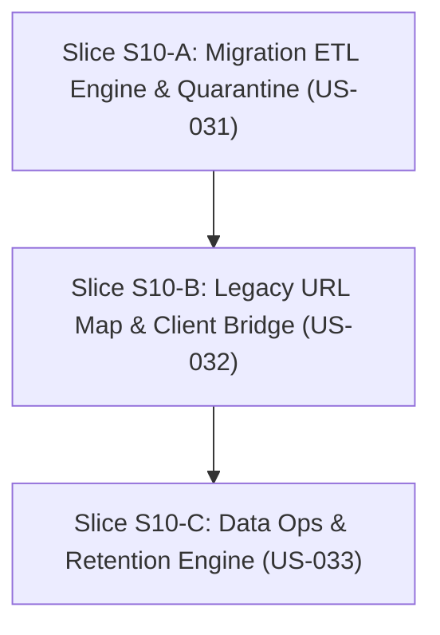

# S10 — Gói chuẩn bị mở gate: Migration content, nguồn và dữ liệu học tập

04/11/2026 · Trạng thái: **SẴN SÀNG TRIỂN KHAI (Gate Opening S10)** · Tài liệu Definition of Ready và kế hoạch kỹ thuật.

Bám sát [S10 README](../phases/P05-production/sprints/S10-migration/README.md), [S10 specs](../phases/P05-production/sprints/S10-migration/specs.md), [SPEC-05](../specs/05-MIGRATION-QUALITY.md) và [WORKFLOW](../standards/WORKFLOW.md).

---

## 1. Snapshot tiến độ hiện tại (04/11/2026)

| Repo | HEAD | Trạng thái |
|---|---|---|
| **arc-academy-backend** | `v0.9.0` (main) | Đã hoàn thành & nghiệm thu S09 (Cohorts, Class Occurrence, Mentor Assignment Scope, Module Settings & Drain, 160 unit/e2e tests, 165 Bruno smoke) |
| **arc-academy-cms** | `v0.9.0` (main) | Đã hoàn thành & nghiệm thu S09 (Cohorts Management, Roster CSV import, Class Occurrence scheduler, Mentor Dashboard, Module Settings, 72 tests) |
| **arc-academy-web** | `v0.9.0` (main) | Đã hoàn thành & nghiệm thu S09 (Student Schedule & Classes, Notification Bell dedup, 1-1 session join window, 58 tests) |
| **backend-nestjs** (docs) | `v0.9.0` (main) | S09 APPROVED (04/11/2026), Release R2 đóng gói thành công |

### Trạng thái các Sprint

| Sprint | Release / Phase | Gate | Ghi chú |
|---|---|---|---|
| **S00–S04** | R1 / P01–P02 | **APPROVED** | Nền tảng, tài liệu, giáo án, bài giảng đồ hoạ |
| **S05–S06** | R1 / P03 | **APPROVED** | Room và engine AI 1-1, server checkpoint, transcript & summary |
| **S07–S09** | R2 / P04 | **APPROVED** | Visual Studio, Adaptive Teaching & Insights, Cohorts & Mentor Lifecycle |
| **S10** | **R3 / P05** | **IN PREPARATION (GATE OPENING)** | Migration content, nguồn, progress, URL legacy & data retention ops |
| **S11** | R3 / P05 | DRAFT | Nghiệm thu core, cutover & chuyển production |

---

## 2. Definition of Ready (DoR) — Đối chiếu điều kiện mở S10

| Điều kiện | Trạng thái | Chi tiết đối chiếu |
|---|---|---|
| Dependency S07, S09 đạt gate | **ĐẠT** | S07 (Visuals/Sources) và S09 (Cohorts/Mentor) đã APPROVED 100% trên `main` |
| User Stories & AC chi tiết | **ĐẠT** | 3 stories: US-031, US-032, US-033 với 9 tiêu chí AC độc lập |
| Dữ liệu nguồn khảo sát (Survey baseline) | **ĐẠT** | Nguồn legacy tại `backend-nestjs/data/arc_irobot_store.json`: 5 courses, 3 roadmaps, 40 unique lessons, 258 quiz items |
| Dữ liệu & Schema Contract | **ĐẠT** | Thiết kế schema `MigrationManifest`, `LegacyMap`, `MigrationException`, `RetentionPlan`, `RetentionPurgeJob` |
| Invariant kiến trúc & bảo mật | **ĐẠT** | Chạy ETL 2 lần idempotent (không record trùng); FK conflicts cách ly vào quarantine (không silently drop); LocalStorage progress đánh dấu provenance `self_reported`; Legacy hash fragment bridge tại client; Chặn purge asset đang được dùng bởi published packages/sessions; Download signed URL có hạn sử dụng và audit redact |

---

## 3. Phân rã User Stories và 3 Slices Triển Khai S10

Ước lượng effort tổng: **10–16 person-days** (theo roadmap Release R3).

### Slice S10-A: Migration ETL Engine & Quarantine (US-031) — 4–6 PD
- **Mục tiêu**: Import dữ liệu từ legacy store (`arc_irobot_store.json`), hỗ trợ dry-run, kiểm tra idempotent 2 lần chạy không duplicate, báo cáo exception và đưa record xung đột vào quarantine, bảo toàn provenance của progress cũ (AC-031-01, AC-031-02, AC-031-03).
- **Backend (`arc-academy-backend`)**:
  - Prisma Models:
    - `MigrationBatch`: `id`, `name`, `source`, `transformerVersion`, `inputHash`, `dryRun`, `status` (`running`, `completed`, `failed`), `summary` (JSON), `createdAt`.
    - `LegacyMapping`: `id`, `source`, `legacyType`, `legacyId`, `targetType`, `targetId`, `batchId`, `metadata` (JSON), `createdAt`. Unique `(source, legacyType, legacyId)`.
    - `MigrationException`: `id`, `batchId`, `legacyType`, `legacyId`, `reason`, `rawPayload` (JSON), `status` (`quarantined`, `resolved`, `ignored`), `createdAt`.
  - Dịch vụ ETL (`src/modules/migration/`):
    - `MigrationService`: Đọc legacy store, transform courses, lessons, quizzes, roadmaps sang model mới của Arc Academy.
    - Idempotency & dry-run runner: So khớp input hash và `LegacyMapping`, rollback transaction nếu là dry-run.
    - Exception quarantine: Bắt FK/Email/Quiz collision đưa vào `MigrationException`.
    - Provenance handler: Gắn nhãn `provenance: "legacy_imported"` hoặc `"self_reported"` cho progress cũ.
  - Endpoints Internal:
    - `POST /api/i/v1/migration/dry-run`: Chạy thử nghiệm ETL và trả về phân tích tác động.
    - `POST /api/i/v1/migration/execute`: Chạy ETL chính thức ghi vào database.
    - `GET /api/i/v1/migration/batches`: Lịch sử các đợt migration.
    - `GET /api/i/v1/migration/exceptions`: Danh sách bản ghi trong quarantine.
    - `POST /api/i/v1/migration/exceptions/:id/resolve`: Xử lý ngoại lệ thủ công.
- **CMS (`arc-academy-cms`)**:
  - Migration Dashboard:
    - Hiển thị danh sách các đợt migration (dry-run vs executed), số lượng courses/lessons/quizzes đã import.
    - Quarantine & Exception Review panel: xem payload lỗi, nguyên nhân xung đột, nút bỏ qua hoặc re-map.

---

### Slice S10-B: Legacy URL Map & Client Bridge (US-032) — 3–5 PD
- **Mục tiêu**: Điều hướng deep links cũ sang cấu trúc bài giảng mới hoặc hiển thị thông báo lưu trữ (read-only archive); client hash-fragment bridge xử lý anchor cũ phía frontend Next.js (AC-032-01, AC-032-02, AC-032-03).
- **Backend (`arc-academy-backend`)**:
  - Endpoint Public:
    - `GET /api/p/v1/legacy/resolve?path=...`: Tra cứu đường dẫn legacy sang URL hiện đại hoặc trạng thái archive.
- **Web (`arc-academy-web`)**:
  - Middleware / Router Resolver:
    - Hỗ trợ các route legacy (ví dụ `/course/:slug`, `/lesson/:id`, `#step-:n`).
    - Client-side bridge component: Bắt URL hash fragments mà server không nhìn thấy để redirect mượt mà tới đúng lesson và beat mục tiêu.
    - Legacy Archive banner: Với các tính năng hoặc nội dung cũ đã ngừng cung cấp (commercial plan cũ, exam ngoài core), hiển thị thông báo Archive rõ ràng, không gây lỗi 404 âm thầm.

---

### Slice S10-C: Data Ops & Retention Engine (US-033) — 3–5 PD
- **Mục tiêu**: Công cụ quản trị vòng đời dữ liệu (Data retention & purge): xem trước fingerprint tác động (preview scope), kiểm tra an toàn chặn xoá tài nguyên đang dùng trong bài giảng hoặc session, hỗ trợ retry idempotent, download bản export qua signed URL có hạn sử dụng và audit redact log (AC-033-01, AC-033-02, AC-033-03).
- **Backend (`arc-academy-backend`)**:
  - Prisma Models:
    - `RetentionPolicy`: `id`, `resourceType`, `retentionDays`, `archivePolicy`, `createdAt`, `updatedAt`.
    - `RetentionJob`: `id`, `policyId`, `cutoffDate`, `dryRun`, `status`, `affectedCounts` (JSON), `fingerprint`, `createdAt`.
  - Retention Service:
    - Tính toán fingerprint dựa trên cutoff date và danh sách đối tượng hết hạn.
    - Chặn xoá: Quét foreign references kiểm tra tài nguyên (asset, source doc, visual) có đang thuộc published package hoặc session đang hoạt động không. Nếu có -> từ chối purge và yêu cầu review.
    - Signed Export Generator: Tạo link tải an toàn hết hạn sau 15 phút, redact thông tin nhạy cảm.
  - Endpoints Internal:
    - `POST /api/i/v1/data-ops/retention/preview`: Sinh preview fingerprint và danh sách đối tượng sẽ bị ảnh hưởng.
    - `POST /api/i/v1/data-ops/retention/execute`: Thực hiện purge/archive có kiểm tra fingerprint khớp.
    - `POST /api/i/v1/data-ops/export`: Xuất dữ liệu tuân thủ kiểm tra quyền và sinh signed download URL.
- **CMS (`arc-academy-cms`)**:
  - Data Ops & Retention Console:
    - Cấu hình retention policy cho transcript, audit log, temporary uploads.
    - Dry-run preview panel với fingerprint xác nhận 2 bước trước khi purge.
    - Lịch sử thao tác purge và danh sách download export bảo mật.

---

## 4. Kế hoạch xác minh & Quality Gates S10

1. **ETL Dry-run & Deduplication Test**:
   - Chạy test dry-run 2 lần liên tiếp trên tập dữ liệu `arc_irobot_store.json`, kiểm chứng số lượng 5 courses / 40 lessons không bị nhân đôi.
2. **Quarantine & Collision Handling Test**:
   - Chạy thử nghiệm với các mock conflict (trùng slug, thiếu FK, lỗi định dạng email) để chứng minh bản ghi được ghi nhận vào `MigrationException` không silently drop.
3. **Legacy URL & Hash Fragment Resolution Test**:
   - Kiểm thử Playwright trên `arc-academy-web` với các đường dẫn legacy và hash `#...` chuyển tiếp chính xác đến bài học.
4. **Purge Protection Test**:
   - Kiểm tra API chặn lệnh purge đối với asset đang được tham chiếu trong Published Lecture Package hoặc Active Classroom Session.
