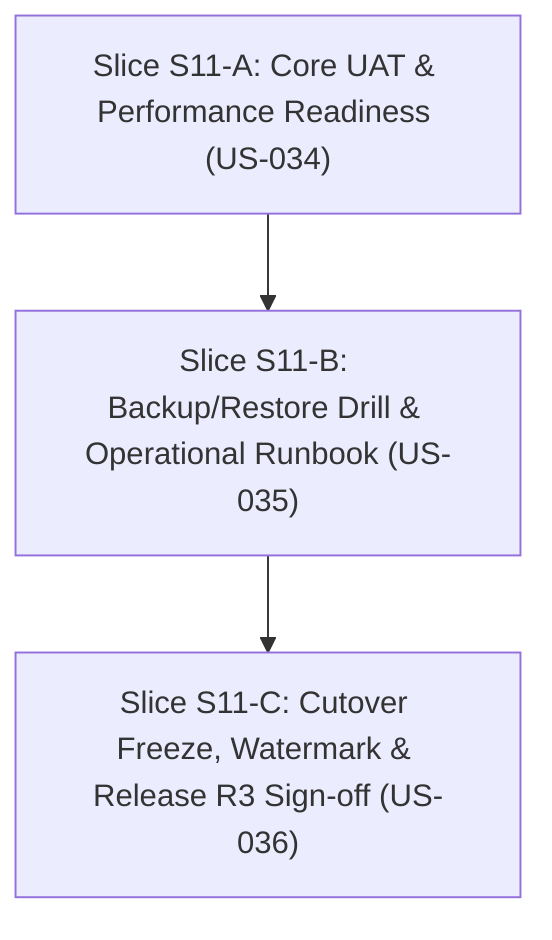

# S11 — Gói chuẩn bị mở gate: Nghiệm thu core và chuyển production

04/11/2026 · Trạng thái: **SẴN SÀNG TRIỂN KHAI (Gate Opening S11)** · Tài liệu Definition of Ready và kế hoạch kỹ thuật.

Bám sát [S11 README](../phases/P05-production/sprints/S11-production/README.md), [S11 specs](../phases/P05-production/sprints/S11-production/specs.md), [SPEC-05](../specs/05-MIGRATION-QUALITY.md) và [WORKFLOW](../standards/WORKFLOW.md).

---

## 1. Snapshot tiến độ hiện tại (04/11/2026)

| Repo | HEAD | Trạng thái |
|---|---|---|
| **arc-academy-backend** | `v0.10.0` (main) | Đã hoàn thành & nghiệm thu S10 (Migration ETL, Legacy Bridge Map, Data Ops Retention, 174 e2e/unit tests, 174 Bruno smoke, 0 vulnerabilities) |
| **arc-academy-cms** | `v0.10.0` (main) | Đã hoàn thành & nghiệm thu S10 (Migration Dashboard, Quarantine Exceptions Review, Retention Purge & Export Ops, 72 tests) |
| **arc-academy-web** | `v0.10.0` (main) | Đã hoàn thành & nghiệm thu S10 (Legacy Bridge URL Resolver, Client Hash-Fragment bridge, Archive Notice, 61 tests) |
| **backend-nestjs** (docs) | `v0.10.0` (main) | S10 APPROVED (04/11/2026), Release R3 Sprint 10 đóng gói thành công |

### Trạng thái các Sprint

| Sprint | Release / Phase | Gate | Ghi chú |
|---|---|---|---|
| **S00–S04** | R1 / P01–P02 | **APPROVED** | Nền tảng, tài liệu, giáo án, bài giảng đồ hoạ |
| **S05–S06** | R1 / P03 | **APPROVED** | Room và engine AI 1-1, server checkpoint, transcript & summary |
| **S07–S09** | R2 / P04 | **APPROVED** | Visual Studio, Adaptive Teaching & Insights, Cohorts & Mentor Lifecycle |
| **S10** | R3 / P05 | **APPROVED** | Migration content, nguồn, progress, URL legacy & data retention ops |
| **S11** | **R3 / P05** | **IN PREPARATION (GATE OPENING)** | Nghiệm thu core, backup/restore drill, cutover freeze & chuyển production |

---

## 2. Definition of Ready (DoR) — Đối chiếu điều kiện mở S11

| Điều kiện | Trạng thái | Chi tiết đối chiếu |
|---|---|---|
| Dependency S08, S10 đạt gate | **ĐẠT** | S08 (Adaptive/Insights) và S10 (Migration/Retention) đã APPROVED 100% trên `main` |
| User Stories & AC chi tiết | **ĐẠT** | 3 stories: US-034, US-035, US-036 với 9 tiêu chí AC độc lập |
| Golden Path UAT Fixture | **ĐẠT** | Fixture c1-l1, course backend-nestjs, 5 legacy courses, AI provider mock, student checkpoints |
| Latency & Performance Budget | **ĐẠT** | SPEC-05 quy định: API p95 read <= 300ms, write <= 800ms; Checkpoint ack <= 1s, resume <= 2s |
| Capability Fallback & A11y | **ĐẠT** | Chế độ degraded mode khi STT/TTS gặp sự cố hoặc browser giới hạn âm thanh; A11y keyboard/focus navigation |
| Backup & Restore Drill Engine | **ĐẠT** | Script export DB + media metadata; Script diễn tập restore blank environment đo RPO & RTO thực tế |
| Outbox Resilience & RPO Audit | **ĐẠT** | Outbox bền vững khi downstream/AI gián đoạn; Không claim giả mạo RPO 15m nếu chỉ có daily snapshot |
| Cutover Writer Freeze & Watermark | **ĐẠT** | Cơ chế `WRITER_FREEZE` chặn các mutation ghi; API Watermark công bố version, commit hash và schema compatibility |
| Runbook Sự cố & Không lùi mù | **ĐẠT** | Quy trình rehearsal -> freeze -> snapshot -> import -> smoke -> approve; Roll-forward hoặc read-only reconcile, tuyệt đối cấm quay lại JSON cũ mù |

---

## 3. Phân rã User Stories và 3 Slices Triển Khai S11

Ước lượng effort tổng: **12–18 person-days** (theo roadmap Release R3).

### Slice S11-A: Core UAT / Performance / Browser Readiness (US-034) — 4–6 PD
- **Mục tiêu**: Kiểm thử toàn vẹn luồng golden path: create course -> source doc -> teaching plan -> visual lecture -> student 1-1 session -> checkpoint -> cross-device resume -> summary & insights; Đo lường latency budget; Chế độ degraded mode khi voice/STT lỗi; Phân tách deterministic mock và live smoke (AC-034-01, AC-034-02, AC-034-03).
- **Backend (`arc-academy-backend`)**:
  - Test suite e2e toàn luồng: `test/core-uat-perf.e2e-spec.ts`.
  - Đo latency phân vị p95 cho các read/write endpoints theo chuẩn SPEC-05.
  - Phân tách deterministic fixture (mock AI provider) và smoke suite.
- **Web (`arc-academy-web`)**:
  - Degraded voice mode indicator & banner trong classroom UI: Khi AudioContext/STT không khả dụng hoặc bị lỗi, tự động chuyển về text chat và hiển thị banner trạng thái degraded.
  - A11y & reduced-motion kiểm tra trong UI classroom.
- **CMS (`arc-academy-cms`)**:
  - Toàn bộ chuỗi tác vụ authoring được kiểm tra qua unit/e2e test suite.

---

### Slice S11-B: Backup/Restore Drill & Operational Runbook (US-035) — 4–6 PD
- **Mục tiêu**: Tự động hoá backup DB + assets metadata; Diễn tập khôi phục môi trường trắng (blank restore drill) đo RPO/RTO thực tế; Kiểm tra tính toàn vẹn foreign keys, citations, asset URIs và session snapshots; Kiểm tra outbox durable khi AI provider outage; Tài liệu hoá chiến lược RPO/RTO minh bạch (AC-035-01, AC-035-02, AC-035-03).
- **Backend (`arc-academy-backend`)**:
  - Script sao lưu: `scripts/backup-core.mjs` - Dump data các schema content, teaching plans, visuals, classroom, cohorts, migration, retention, auth kèm metadata hash SHA256.
  - Script diễn tập khôi phục: `scripts/restore-drill.mjs` - Restore vào DB trắng, đo RTO, verify row counts, foreign key integrity và semantic references.
  - Test suite outbox resilience: Kiểm tra bền vững dữ liệu khi Redis/AI provider gián đoạn.
  - Tài liệu runbook: `docs/runbooks/BACKUP-RESTORE-RUNBOOK.md` xác lập rõ RPO của Daily dump (24h) và WAL continuous archiving (<=15m).

---

### Slice S11-C: Cutover Production, Writer Freeze & Release R3 (US-036) — 4–6 PD
- **Mục tiêu**: Thiết lập cơ chế Writer Freeze / Maintenance Mode ngăn chặn ghi dữ liệu trong quá trình cutover; Endpoint System Watermark trả về release hash và watermark di chuyển; Release Manifest đóng gói Release R3 v1.0.0; Runbook ứng cứu sự cố không quay lại JSON cũ mù (AC-036-01, AC-036-02, AC-036-03).
- **Backend (`arc-academy-backend`)**:
  - Guard / Middleware `WriterFreezeGuard`: Khi cấu hình `WRITER_FREEZE=true`, từ chối các HTTP mutations (POST, PUT, PATCH, DELETE ngoại trừ login/health) với HTTP `503 Service Unavailable` hoặc `423 Locked` kèm header `Retry-After: 300`.
  - System Module:
    - `GET /api/p/v1/system/watermark`: Public metadata & cutover status.
    - `GET /api/i/v1/system/watermark`: Internal detail watermark, git commit, migration status, writer freeze state.
  - Cập nhật OpenAPI, Bruno requests 174 -> 176.
- **Tài liệu & Release Manifest**:
  - Runbook chuyển giao: `docs/runbooks/CUTOVER-RUNBOOK.md`.
  - Runbook sự cố: `docs/runbooks/INCIDENT-RESPONSE.md`.
  - Release Manifest: `backend-nestjs/docs/upgrade-3-repos/implementation/release-manifest.json` và `RELEASE-R3.md`.
  - Biên bản nghiệm thu S11: `backend-nestjs/docs/upgrade-3-repos/acceptance/2026-11-04-S11-production/`.

---

## 4. Kế hoạch xác minh & Tiêu chí hoàn thành (DoD)

1. **Backend**:
   - `pnpm test` & `pnpm test:e2e` pass 100%.
   - Latency budget benchmark đạt chỉ tiêu: API p95 <= 300ms, Checkpoint ack <= 1s, resume <= 2s.
   - Script `backup-core.mjs` & `restore-drill.mjs` chạy thành công không lỗi, RTO thực tế < 1 phút trên local test runner.
   - Writer freeze guard hoạt động chính xác khi kích hoạt.
   - OpenAPI schema & Bruno smoke tests cập nhật đầy đủ.
2. **CMS & Web**:
   - CMS: Foundation check pass, 72/72 tests pass.
   - Web: Foundation check pass (light-only rule compliant, 0 dark tokens), 61+ tests pass, capability fallback test pass.
3. **Docs / Release**:
   - Biên bản nghiệm thu S11 đầy đủ (`signoff.json`, `signoff-run.json`, `SIGNOFF.md`, `REPORT.md`).
   - Đóng gói Release R3 `v1.0.0` toàn dự án.
