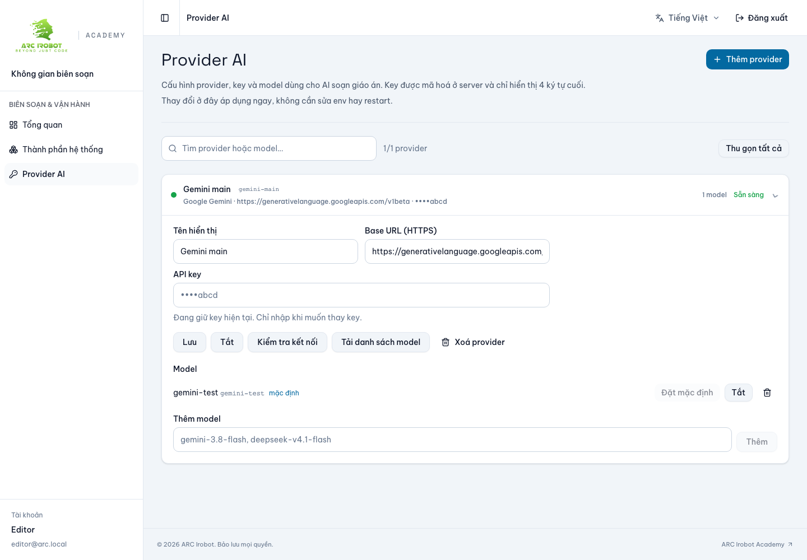
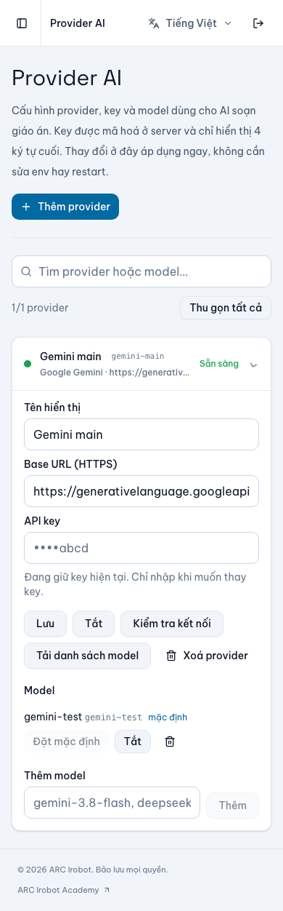

# CMS/Web UI quality repair — 29/10/2026

ĐẠI CA yêu cầu ưu tiên tối đa component shadcn có sẵn, sửa layout CMS, request session khi hover, feedback submit và action provider. Đây là sửa chất lượng nền tảng/luồng đang có; không mở sprint tính năng mới, không commit/push/deploy.

## Nguyên nhân đã xác nhận trong source

- CMS router `defaultPreload: 'intent'` chạy guard dùng `fetchQuery(sessionQuery)` trong khi session `staleTime: 0`. Hover liên tục trở thành request `/auth/me`; `useSession` cũng quan sát cùng query luôn stale.
- Shell CMS tự dựng sidebar desktop và menu mobile riêng bằng grid; chưa dùng shadcn Sidebar/Sheet.
- Provider có action chạy Promise trực tiếp ngoài MutationCache; thiếu pending lock và toast. Delete dùng `window.confirm`, disclosure dùng `details`. Form tạo provider thiếu validation schema/field errors.
- Có Toaster trong cả hai app nhưng QueryClient chưa có error feedback chung.
- NativeSelect hiện có provenance từ registry shadcn, không phải bằng chứng component tự chế. Không đánh đồng mọi semantic HTML hay composition (ví dụ PageHeader) với việc viết lại primitive có sẵn.

## Thay đổi

- CLI shadcn pin 4.23.0, tra registry qua MCP và xem example; thêm Sidebar/Sheet/Separator/Tooltip/Skeleton/Accordion/AlertDialog/Select vào CMS, Accordion vào Web. Giữ Button/Input có adaptation, bỏ dependency `cn` mà CLI tự thêm, sửa import về `@/core/utils/cn`, bỏ dark classes/palette do registry thêm.
- CMS dùng SidebarProvider/Sidebar/SidebarInset/SidebarMenuButton và mobile Sheet. SidebarInset adaptation render div để chỉ có một main landmark; Escape trả focus về trigger; chọn route đóng menu mobile. Giữ token/font/logo light-only.
- Sửa intrinsic min-width của Accordion trigger và grid form, Select trigger/content để URL/protocol dài không kéo tràn 390px; toolbar search dùng cả dòng trên mobile. Map border mặc định về token thương hiệu ở cả hai app.
- Session cache hữu hạn 60 giây. Intent preload dùng `ensureQueryData`; điều hướng dùng `fetchQuery` để revalidate khi hết hạn. Login/logout vẫn clear cache. API server tiếp tục kiểm quyền.
- MutationCache hiển thị toast lỗi localized trên CMS/Web, kể cả mutation có inline error handler. Giữ inline errors để có vị trí và nội dung phục hồi.
- Provider list/presets có queryOptions/key factory theo account. Action cập nhật/verify/discover/import/model đều dùng TanStack mutations và pending state; invalidation danh sách/provider budget sau acknowledgement; toast thành công cho action provider.
- Create form dùng RHF/Zod, `noValidate`, lỗi VI/EN gắn field, focus trường lỗi, HTTPS URL validation. Key input khi sửa để trống, hint là placeholder; chỉ gửi key mới khi nhập và xóa input sau lưu thành công.
- Provider dùng shadcn Select/Accordion/AlertDialog; readiness chỉ đúng khi default model tồn tại và enabled. Bổ sung nhãn accessible cho xóa model, bản dịch nút hủy.
- Các disclosure provenance/checkpoint trong CMS AI plan, FAQ và cấu trúc khóa học trên FE dùng Accordion. Link action mở khóa học dùng Button asChild.
- ESLint chặn native details/summary/dialog và window.alert/confirm/prompt ngoài core/ui; có rule regression tests. Tiếp tục cấm native form controls ở feature, explicit TypeScript any và import ngược từ core.

## Kiểm chứng và giới hạn

Log, ảnh và số liệu cuối được lưu tại [acceptance/UI-QUALITY-2026-10-29](../acceptance/UI-QUALITY-2026-10-29/).

- Chạy quality:check, production build, MCP transport/registry check trên cả CMS và Web.
- CMS browser tests: auth/permission guards, VI/EN, OS light/dark; `/me` chỉ một request sau hover navigation; provider save lỗi toast → retry đúng payload không gửi hint; validation + keyboard Select; sidebar mobile Escape/focus/route close; overflow desktop, mobile collapsed/expanded/create/select.
- CMS provider unit tests: create, update, verify, discover/import, default model, toggle/remove model, confirmation xóa provider, pending lock, invalid default readiness. Session cache test kiểm preload không refetch dữ liệu stale và navigation revalidate sau TTL.
- Web browser tests: FAQ keyboard VI/EN, auth form/locale/brand/mobile/light mode, inline error + toast lỗi submit.
- Browser action provider sử dụng HTTP fixtures với payload/envelope contract, không gọi provider bên ngoài hay dùng key thật. Chưa xác nhận mọi provider/action với tài khoản thật và upstream thật. Course catalog Accordion chưa có browser scenario với catalog có dữ liệu thật.
- Coverage là số toàn application (không loại bỏ nghiệp vụ), còn thấp; không dùng số test pass làm chứng nhận toàn CMS/Web đạt UX hoặc production integration. Các test live/full stack/content/teaching-plan riêng ngoài tập đã ghi nhận không được coi là chạy lại trong đợt này.
- FE kiểm production build mới trên cổng local riêng 3101 vì process preview có sẵn ở 3001 giữ bundle cũ; không dùng kết quả runtime cũ để đánh giá build mới. Dừng server kiểm thử do em tạo sau khi hoàn tất; không restart process khác.
- Giữ thay đổi có sẵn của các công việc khác, generated clients không sửa tay. Không commit.

## Kết quả cuối

| Gate | CMS | Web |
| --- | --- | --- |
| quality:check | PASS | PASS |
| Unit tests | 54 PASS | 44 PASS |
| Rule regression tests | 5 PASS | 5 PASS |
| Application line coverage | 36.11% | 16.71% |
| Production build | PASS | PASS |
| Browser tests trong tập nêu trên | 14 PASS | 9 PASS |
| MCP initialize/inventory/registry lookup | PASS | PASS |

Ảnh dùng dữ liệu fixture, không phải provider production:

